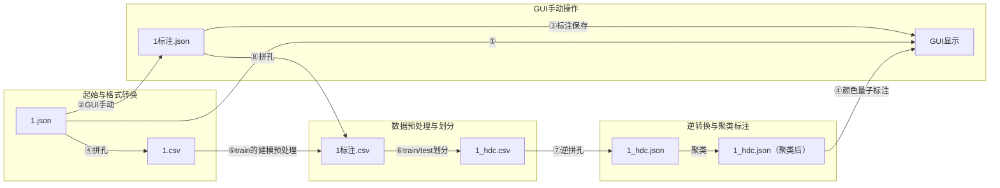

超声探头沿x移动，超声波沿y传播。
A显深度值d 幅度值a 
B显左上角原点 x向右 y向下

，B 型图像设计 在 X 轴方向分辨率 是 3mm ，而在 Y 轴方向分辨率 是 1mm 。
上文中最终 Y 坐标为：Y=y/3=Ymax*d/3
不同通道的探头位置不同，绘制 B 显的起点也不同，需要在通道的 X 坐标上加上一
个偏置参数 b，在仪器使用过程中称为 “拼孔值 ”。另外 ，随着探头的移动 ，已绘制的 B 显
点需要自左向右移动，其 X 坐标需要不断累加移动距离，这个距离等于编码轮输出的编
码脉冲个数，即编码值 ∆x，
X=X+b+∆x
读取的深度值其实是声程值，已有角度为俯仰角，但是实际上还有水平角。4个斜向通道其实还有水平角，默认20°  所以这四个斜向的通道深度在画图时还需要在原来基础上再×cos20°。其他5个通道的水平角就是0.所以在使用深度值画图以及深度值计算的编码偏差时 ，深度=声程*cos水平角*cos俯仰角   偏差 =声程*cos水平角*sin俯仰角 
B 型显示数据是探伤仪移动等距离间隔生成的 ，主要使用深度值 、角度值 、拼孔值和
编码值四个主要参数计算 B 显点坐标 。其中深度值和编码值是自动产生的 ，角度值对应固
定的通道号 ，拼孔值与探头位置相关 ，也对应固定的通道号 。在同一个编码值下 ，为了避
免混淆可能出现多个通道的深度值，可使用通道号来区分不同的角度值和拼孔值。因此 ，
B 显数据结构最终可以看作是一个二维矩阵 ，如下图所示 ，行表示通道号 ，列表示编码值 ，
矩阵元素为深度值 。为了匹配 B 显自左向右的播放方向 ，矩阵最右一列为起始编码值 ，新
编码值对应产生的深度值自右向左填充。
将现有不包含幅度信
息的 B 显点视为具有 100% 幅度的信号 ，类似距离变换处理二值图像的原理 ，将连续 B 显
点图形整体和边缘幅度适度降低 。标定数据和现场数据的完整性 、增益值和草状波积分值
的综合分析结果将作为进行变换处理的主要参数 。

表 5 钢轨伤损类型分类
序号 伤损类型
1 轨头外侧核伤
2 轨头中心核伤
3 轨头内侧核伤
4 轨头内、外、中心核伤
5 轨头内、中心核伤
6 轨头外、中心核伤
7 轨头水平分裂
8 轨头、轨腰分裂
9 轨腰水平裂
10 轨底断裂
11 螺孔裂纹
12 其他伤损
伤损 1-6 是由直 70 °通道和斜 70 °通道所能发现的伤损，伤损 7-11 是由 37 °和 0° 通道所能发现的伤损 。根据伤损发现的通道和形态区别 ，将伤损分为五大类 ：核伤类 、水
平裂纹类 、轨底裂纹类 、螺孔裂纹类 和其他类 。根据伤损的位置可分为四大类 ：轨头伤损 、
轨腰伤损、轨底伤损和其他伤损。


表 6 正常结构类型分类
序号 结构类型
1 接头
2 螺孔
3 导线孔
4 焊缝
5 鱼鳞伤
6 轨底锈蚀
7 轨底焊筋
8 道岔
9 其他
第二类结果是正常的钢轨结构 ，包括钢轨接头 、螺孔 、导线孔 、焊缝等等 ，依然需要
判别出来，以减少现场复核的工作量和避免错判引起的切轨换轨。

超维计算的基本训练与测试方法 [35] ：设有一个识别任务 ，训练样本共有 Nc个种类 ，
每类中各有 Ns 个样本 ，超维计算训练与测试过程的整体模型框架如下图所示，其中具体
的训练过程描述如下。
步骤 1：通过随机选择将样本中的地址逐一编码为地址超维向量 ，通过连续映射将值
域范围内的离散数值逐一编码为数值超维向量 ，编码好的地址与数值超维向量存储在被称
为项目存储器的存储空间中，作为原料提供给后续算法取用。
步骤 2：对每个训练样本进行编码，编码结果经过标准化处理后共得到 Nc·Ns个超维
向量 ，称为训练超维向量，记为 Ri(i=1, 2, ..., Nc·Ns)。
步骤 3：将属于同一类的训练超维向量再次通过加法运算组成一个集合 ，记为 �෩k(k=1,
2, ..., Nc)，将�෩k经过标准化处理后得到 Nc个超维向量 ，称为类别超向量 ，记为 Ck(k=1, 2, ..., Nc)，Ck与类别标签一起存储在被称为联想存储器的存储空间中，完成训练。
超维计算的测试过程同样也非常简洁 ，主要通过超维向量之间的相似度关系完成识
别，具体步骤描述如下 ：
步骤 1：对测试样本使用项目存储器中的地址超维向量和数值超维向量 ，通过与训练
样本相同的编码方式进行编码 ，编码结果称为查询超维向量 ，记为 Q。
步骤 2：通过相似度衡量方法 ，分别计算 Q 与联想存储器中的 Nc个类别超维向量 Ck
之间的相似度。
步骤 3：最高类相似度所对应的类别即为超维计算判别的测试样本所属类别。

自适应预处理 。在回放分析智能判别中使用自适应预处理 ，利用数据结构
读取参数信息 ，完成参数矫正 、噪声抑制 、错误提醒等功能 ，提升特征提取效果 ，形成数
据质量管理办法，减少被动受人为因素干扰的影响。

设计钢轨探伤 B 显全数据结构，加入信号幅度值，研究增益设置与标定数据完
整性、草状波积分值的关系模型，解决数据标准化问题，提出数据管理解决方案。
（2
假如第一B显点1通道存在一个深度为125mm幅度为80%的报警信号，用JSON格式表示为：
{"B1":[1,125,80]}
假如7通道存在深度为125mm幅度为80%的第一报警信号，在深度为130mm幅度75%的第二报警信号，用JSON格式表示为：
{"B1":[7,125,80]}
{"B2":[7,130,75]}


数值对应超维向量应使用连续映射，汉明距离均匀变化
循环移位编码用来表示多个点的深度值，每个点的深度值对应一个超维向量，多个点的深度值可以通过循环移位编码表示为一个超维向量。、
一个伤损由多个点构成，相近的编码值使用以为表示空间上的关联，即空间上的关联度增加。一个伤损可能由多个通道的点构成，每个通道的点的深度值对应一个超维向量，多个通道的点的深度值可以通过循环移位编码表示为一个超维向量。但是有的伤损只由单个通道的点构成，这种伤损可以直接使用该通道的点的深度值对应超维向量表示。


9个通道应该分开。单独处理，


为什么余弦距离衡量超维向量之间的相似度，？因为点积


咱们设计原则：
1、现场检测，能耗优先，对于智能判伤的结果，可以立刻复核，也就是倒车再探测一遍，后面还有回放分析。即使准确率低3%，我觉得问题也不大。
2、回放分析，准确率优先，这个不能漏报，至少是对试块检测的结果，绝对不能漏报。客户对这一点非常看重。


选中的点使用橙色高亮显示。 取消开始标注 保存标注 加载标注的按钮  。在显示已选中的点信息区域右侧增加原本开始标注要选择的结构或者伤损选项，这里再加一个保存标注按钮即可不用选择保存路径，直接保存到原始数据路径的同级目录即可。而且标注数据不作为新的json保存，而是将原始数据文件名加上已标记后保存。比如170921_16229片段.xxc.json  的标注数据就保存为170921_16229片段.xxc标注.json  如果已存在标注.json那么新的标注就保存在已有的标注.json里即可。
再加一块区域显示已标注的的结构或伤损。，可选择，选择后显示构成该标注的所有点的信息，另外需要对该标注画框，使用灰色框加灰色文字。灰色框为框住所有点的最小矩形。灰色文字就是该标注名  比如螺孔1.


 不需要将HDC融合进gui   只需要考虑如何将训练数据.json和训练数据标注.json作为输入进hdc算法，然后训练hdc模型  然后模型训练好后。将测试数据里面的json再作为输入然后输出每个点的识别情况后生成对应的测试数据标注的json   也就是说hdc算法最终输出是测试数据标注.json   然后我会自己手动查看测试数据的标注正确性


 数据标注工作：我先手动标注一些数据，


EMG手势数据结构分析
EMG数据集结构

数据形状: [256, 4]  (256个时间点 × 4个通道)
四列含义:
├── 第1列: EMG传感器1的信号值 (浮点数，范围约0-0.25)
├── 第2列: EMG传感器2的信号值  
├── 第3列: EMG传感器3的信号值
└── 第4列: EMG传感器4的信号值
LABEL_1.csv - 标签数据：
标签值: 1, 2, 3, 4, 5 (代码中会减1变成0-4索引)
对应手势:
├── 0: "Closed hand" (握拳)
├── 1: "Open hand" (张开手掌)  
├── 2: "Two-finger pinch" (两指捏合)
├── 3: "Point index" (伸出食指)
└── 4: "Rest position" (休息姿势)
数据处理流程
滑动窗口采样: 从连续的EMG信号中每256个时间点作为一个样本
降采样: 为了减少计算量，将256点降采样到约51点 (DOWNSAMPLE=5)
HDC编码: 使用Level嵌入将连续信号值编码为超向量


# 你的超声波数据结构对应
你的数据格式建议:
├── 9个通道 (对应9个超声波探头)
├── 每个通道包含: [编码值序列, 深度值序列, 幅度值序列]
├── 时间维度: B显数据的扫描序列
└── 标签: 正常结构 vs 伤损类型

# 类似EMG的数据组织方式:
BScan样本格式建议:
├── 形状: [扫描长度, 9, 特征数]  
├── 特征数: 3 (深度, 幅度, dB值)
├── 时间窗口: 沿着编码方向的滑动窗口
└── 标签: 伤损类别 (核伤、裂纹等)


csv10列数据，分别代表：编码值 通道0-8的深度值 类别
例如 {"E":5,"B1":[8.0,176.0,100.0,257.0,176.0]}  就转换成 5,8,0,0,0,0,0,0,0,0,176.0,100.0,257.0,176.0,0
E可以对应多个B1，比如 {"E":5,"B1":[2.0,136.0,100.0,257.0,176.0],"B1":[8.0,126.0,100.0,257.0,176.0]}
 就转换成 5,2,0,0,136,0,0,0,0,0,126.0,0
 类别默认0 0代表未识别或者正常，类别从标注.json中获取, 根据类别的E值,修改这一行最后一列的值          
            "轨头外侧核伤": 1,
            "轨头中心核伤": 2,
            "轨头内侧核伤": 3,
            "轨头内、外、中心核伤": 4,
            "轨头内、中心核伤": 5,
            "轨头外、中心核伤": 6,
            "轨头水平分裂": 7,
            "轨头、轨腰分裂": 8,
            "轨腰水平裂": 9,
            "轨底断裂": 10,
            "螺孔裂纹": 11,
            "接头": 12,
            "螺孔": 13,
            "导线孔": 14,
            "焊缝": 15,
            "鱼鳞伤": 16,
            "轨底锈蚀": 17,
            "轨底焊筋": 18,
            "道岔": 19,


             "annotations": [
    {
      "id": "2",
      "type": "结构",
      "subtype": {
        "id": "101",
        "name": "螺孔"
      },
      "points": [
        {
          "e": 592,
          "channel": 6,
          "depth": 90.0,
          "amplitude": 100.0
        },
        {
          "e": 593,
          "channel": 6,
          "depth": 87.0,
          "amplitude": 100.0
        },
        {
          "e": 594,
          "channel": 6,
          "depth": 85.0,
          "amplitude": 100.0
        },
        就是e= 592 593 594 的类别为 13


# HDC训练与识别流程

## 1. 训练流程

### 1.1 数据预处理
1. **数据转换**：使用`ultrasonic_data_converter.py`将JSON格式的原始数据转换为CSV格式
   - 输出格式：编码值 + 9通道深度值 + 类别
   - 支持批量处理目录中的所有数据文件

2. **数据划分**：将数据集划分为训练集和测试集
   - 建议比例：70%训练集，30%测试集
   - 确保类别分布均匀

3. **滑动窗口采样**（可选）：
   - 窗口大小：根据数据特点调整，建议64
   - 滑动步长：建议32
   - 用于处理连续的时间序列数据

4. **数据归一化**（可选）：
   - 对深度值进行归一化，范围[0, 1]
   - 提高模型训练效果

### 1.2 特征提取
1. **通道分离**：9个通道分开处理，每个通道单独编码
2. **超维编码**：
   - 使用连续映射将深度值编码为超维向量
   - 汉明距离均匀变化
   - 循环移位编码表示多个点的深度值
3. **特征融合**：将多个通道的超维向量融合为一个表示

### 1.3 模型训练
1. **模型初始化**：
   - 超维空间维度：建议10,000
   - 类别数量：20（0-19）
2. **训练过程**：
   - 遍历训练样本，生成超维向量
   - 使用捆绑（bundle）操作聚合同类样本的超维向量
   - 生成类别超向量
3. **模型保存**：
   - 保存训练好的类别超向量
   - 支持模型加载和增量训练

## 2. 识别流程

### 2.1 实时识别流程
1. **数据采集**：实时获取超声波数据
2. **数据转换**：将原始数据转换为超维向量
3. **相似度计算**：计算输入超向量与类别超向量的相似度
4. **类别判决**：选择相似度最高的类别作为识别结果
5. **结果输出**：
   - 生成JSON格式的标注文件
   - 包含识别的伤损/结构类型和位置信息

### 2.2 离线识别流程
1. **数据加载**：加载测试数据JSON文件
2. **数据转换**：使用`ultrasonic_data_converter.py`转换为CSV格式
3. **特征提取**：生成超维向量
4. **模型加载**：加载训练好的模型
5. **识别预测**：对每个测试样本进行分类
6. **结果生成**：生成测试数据的标注JSON文件

## 3. 模型评估

### 3.1 评估指标
1. **准确率**：正确识别的样本数/总样本数
2. **精确率**：针对每个类别的正确识别率
3. **召回率**：针对每个类别的召回率
4. **F1分数**：精确率和召回率的调和平均

### 3.2 评估方法
1. **交叉验证**：使用k-fold交叉验证评估模型性能
2. **混淆矩阵**：分析不同类别之间的混淆情况
3. **ROC曲线**：评估模型的区分能力

## 4. 优化策略

### 4.1 训练优化
1. **超参数调优**：
   - 超维空间维度
   - 滑动窗口大小
   - 学习率（如果使用）
2. **数据增强**：
   - 添加噪声
   - 旋转
   - 缩放

### 4.2 识别优化
1. **实时性优化**：
   - 优化超维编码速度
   - 使用并行计算
2. **准确率优化**：
   - 多模型融合
   - 自适应阈值调整

## 5. 参考EMG手势识别的实现

### 5.1 相似点
1. **时间序列数据**：都处理连续的时间序列数据
2. **多通道数据**：EMG有4通道，超声波有9通道
3. **滑动窗口采样**：都使用滑动窗口处理连续数据
4. **超维编码**：都使用连续映射将数值编码为超维向量

### 5.2 改进点
1. **通道分离处理**：9个通道分开处理，每个通道单独编码
2. **循环移位编码**：使用循环移位编码表示多个点的深度值
3. **多B1数据处理**：支持同一E值对应多个B1数据项
4. **标注数据处理**：准确根据E值匹配数据行和标注

# 输出格式说明

## 1. CSV输出格式

```
encoding,channel_0,channel_1,channel_2,channel_3,channel_4,channel_5,channel_6,channel_7,channel_8,label
5,8.0,0.0,0.0,0.0,0.0,0.0,0.0,0.0,0.0,13
6,0.0,0.0,0.0,0.0,0.0,0.0,0.0,0.0,0.0,0
7,0.0,0.0,0.0,0.0,0.0,0.0,0.0,0.0,0.0,0
```

## 2. 标注JSON输出格式

```json
{
  "annotations": [
    {
      "id": "1",
      "type": "结构",
      "subtype": {
        "id": "101",
        "name": "螺孔"
      },
      "points": [
        {
          "e": 592,
          "channel": 6,
          "depth": 90.0,
          "amplitude": 100.0
        },
        {
          "e": 593,
          "channel": 6,
          "depth": 87.0,
          "amplitude": 100.0
        }
      ]
    }
  ]
}
```

节点与编号对应说明
 
1. ①：原始 1.json 直接输出至GUI显示
 
2. ②：通过GUI手动操作，将 1.json 转为 1标注.json 
 
3. ③： 1标注.json 的标注结果保存后输出至GUI显示
 
4. ④：包含两个环节—— 1.json 转 1.csv 的拼孔、聚类后 1_hdc.json 的颜色量子标注并输出至GUI
 
5. ⑤： 1.csv 经train建模预处理后汇入 1标注.csv 
 
6. ⑥： 1标注.csv 划分train/test集后生成 1_hdc.csv 
 
7. ⑦： 1_hdc.csv 经逆拼孔转为 1_hdc.json 
 
8. ⑧： 1标注.json 经拼孔转为 1标注.csv


不要降采样，


参考手势识别，手势识别和超声存在不同。手势识别虽然是多通道。但是1个时间手势只会有一个结果。所以256个时间点 × 4个EMG传感器通道就能表示。

手势识别256个时间点 × 4个EMG传感器通道表示1个手势，超声256个时间点 × 9个通道表示1段距离超声样本。


我有一个问题，训练输入的标注数据，是否应该把不构成伤损的点变成0再输入？还是直接输入标注的原始数据？


F1 分数 (F1-Score) 是机器学习中「分类任务」的核心综合评价指标，本质是 「精准率 (Precision)」和「召回率 (Recall)」的「调和平均数」

「准确率 (Accuracy)」：预测正确的样本数总样本数。但准确率有致命缺陷：样本不平衡时完全失效
✅ TP (True Positive 真阳性)：模型判定为「有缺陷」，样本实际也「有缺陷」→ 探伤中「正确识别出缺陷」，最想要的结果
✅ TN (True Negative 真阴性)：模型判定为「无缺陷」，样本实际也「无缺陷」→ 探伤中「正确识别出无缺陷」
❌ FP (False Positive 假阳性)：模型判定为「有缺陷」，样本实际「无缺陷」→ 探伤中「误判、无缺陷当成有缺陷」（也叫「误报」）
❌ FN (False Negative 假阴性)：模型判定为「无缺陷」，样本实际「有缺陷」→ 探伤中「漏检、有缺陷当成无缺陷」（也叫「漏报」，探伤中最致命的错误！）
✔️ 精准率 (Precision，简写 P)
公式
Precision=TP+FPTP​
白话解读（探伤场景）

模型判断为「有缺陷」的所有样本中，真正确实有缺陷的样本占比。

✔️ 召回率 (Recall，简写 R，也叫查全率 / 灵敏度 Sensitivity)
公式
Recall=TP+FNTP​
白话解读（探伤场景）

所有实际确实有缺陷的样本中，被模型成功找出来的样本占比。

F1 分数是「精准率」和「召回率」的调和平均数，不是算术平均数！F1=2×Precision+RecallPrecision×Recall​

✅ 核心特点：F1 高分的唯一途径 → 精准率和召回率都要高，完美契合探伤场景的需求：既要「少误判」，又要「少漏检」。
、

ROC 曲线（受试者工作特征曲线）：横轴是「假阳性率 FPR」，纵轴是「真阳性率 TPR」，绘制出的一条曲线；
AUC 值（曲线下面积）：ROC 曲线下方的面积大小，是对 ROC 曲线的数值化总结，取值范围 0 ≤ AUC ≤ 1。
✔️ 前置 2 个核心率值（探伤场景解读，必考）
真阳性率 TPR = Recall = 召回率 = TP/(TP+FN)：所有真实缺陷中，被模型检出的比例 → 就是「缺陷检出率」，越高越好；
假阳性率 FPR = FP/(FP+TN)：所有真实良品中，被模型误判成缺陷的比例 → 就是「误报率」，越低越好；
✔️ AUC 值的核心意义（探伤场景专属，记死）
AUC = 1 → 模型完美，所有缺陷都被检出，无任何误报；
0.95 ≤ AUC < 1 → 模型效果优秀，满足工业探伤的落地要求（你的项目建议达标值）；
0.9 ≤ AUC < 0.95 → 模型效果良好，可使用但需调参优化；
0.8 ≤ AUC < 0.9 → 模型效果一般，必须优化算法（如 HDC 的维度、窗口大小）；
AUC = 0.5 → 模型和「随机猜」没有区别，完全无效；
AUC < 0.5 → 模型预测结果和真实情况相反，逻辑错误，需重构。

✅ 1. Fβ 分数 (F-beta Score) 【F1 的升级版，探伤场景 必用！】
✔️ 核心定义
F1 分数是「精准率和召回率同等重要」的特例，而 Fβ 分数是 F1 的通用形式，可以通过参数 β 调整「召回率」和「精准率」的权重，完美适配你的探伤场景！核心公式：Fβ​=(1+β2)×β2×Precision+RecallPrecision×Recall​
✔️ β 值的核心意义（探伤场景 重中之重）
β 是权重系数，β > 0，取值决定了「召回率」和「精准率」的重要性：

✅ β=1 → 就是标准 F1 分数，精准率和召回率权重相等；
✅ β=2 → 得到 F2 分数，召回率的权重是精准率的 2 倍 → 探伤场景的「黄金指标」！！👉 白话解读：模型会「优先保证召回率（少漏检）」，哪怕精准率略有下降也没关系，完美契合探伤的核心需求：漏检的代价远大于误判；
✅ β=0.5 → 得到 F0.5 分数，精准率的权重是召回率的 2 倍，适合「误判代价更高」的场景（探伤场景几乎不用）。

你的代码里，一定要把 F2 分数 作为核心指标之一，F2≥0.85 是探伤模型的硬性达标线！

. 马修斯相关系数 (MCC，Matthews Correlation Coefficient) 【二分类 黄金标准，探伤必用】
✔️ 核心定义
MCC 是二分类任务的「终极评价指标」，被称为「最公平的分类指标」，取值范围：−1≤MCC≤1。它综合了混淆矩阵的所有 4 个值（TP/TN/FP/FN），对样本平衡、样本极度不平衡场景都完全适用，没有任何短板！
✔️ 取值意义（探伤场景 专属解读）

MCC = 1 → 模型完美，无漏检、无误判；
0.9 ≤ MCC < 1 → 模型效果优秀，工业级探伤可用；
0.7 ≤ MCC < 0.9 → 模型效果良好，需微调；
0 < MCC < 0.7 → 模型效果一般，需优化；
MCC = 0 → 模型和随机猜无区别；
MCC < 0 → 模型预测结果与真实情况相反，逻辑错误。

✔️ 核心优势
MCC 是唯一能在「样本极度不平衡」时，真实反映模型性能的单值指标，比如你的探伤样本缺陷占比 0.1%，F1 可能偏高，AUC 可能美化，但 MCC 能给出最真实的分数。✅ 结论：你的探伤项目，MCC ≥ 0.85 是模型验收的核心标准之一！

、💯 【终极总结】你的「超声波 HDC 探伤系统」指标使用优先级（重中之重，直接抄作业）
这是你最需要的核心结论！所有指标的优先级、适用场景、达标阈值 全部整理好，你在代码里按这个来，绝对不会出错，完美适配你的开发需求：
✅ 【第一梯队：核心验收指标，必须用，缺一不可】
PR-AUC / AP 值 → 优先级★★★★★，极度不平衡样本的黄金指标，达标阈值 ≥ 0.9；
F2 分数 → 优先级★★★★★，优先保证召回率（少漏检），达标阈值 ≥ 0.85；
马修斯相关系数 (MCC) → 优先级★★★★★，最公平的单值指标，达标阈值 ≥ 0.85；
漏检率 (FNR) → 优先级★★★★★，一票否决指标，达标阈值 ≤ 0.01（漏检率≤1%）。
✅ 【第二梯队：辅助评估指标，必看，用于优化模型】
ROC-AUC → 快速筛选模型，达标阈值 ≥ 0.95；
误报率 (FPR) → 控制生产成本，达标阈值 ≤ 0.05；
特异度 (Specificity) → 良品识别率，达标阈值 ≥ 0.9；
✅ 【第三梯队：场景化指标，按需使用】
准确率 (Accuracy) → 仅样本均衡时参考；
Kappa 系数 → 有人工标注时用；
LogLoss → 模型输出概率时用；
多分类加权指标 → 做缺陷类型分类时用。
六、💯 【一站式实战代码】所有指标 Python 实现（直接复制嵌入你的探伤项目）
你的项目是 Python 开发，以下代码基于你最常用的scikit-learn库，整合了上述所有核心指标：二分类 + 多分类、F1/F2、PR-AUC/ROC-AUC、MCC、漏检率 / 误报率、混淆矩阵，无缝嵌入你的 ultrasonic_hdc_emg_style.py 训练预测模块，直接替换你的真实数据即可！

增加一个


以最后面一个点为基准，其他通道的点通过拼孔值挪到和这个点一起


手势识别4个通道 构成1个结果  ，但是超声伤损所组成