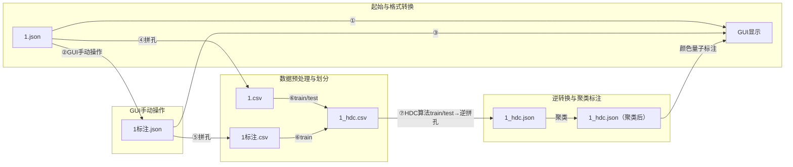

**节点说明**:
1. **①**: 原始1.json直接输出至GUI显示
2. **②**: 通过GUI手动操作，将1.json转为1标注.json
3. **③**: 1标注.json的标注结果保存后输出至GUI显示
4. **④**: 包含拼孔处理，1.json转1.csv
5. **⑤**: 1.csv经train建模预处理后汇入1标注.csv
6. **⑥**: 1标注.csv划分train/test集后生成1_hdc.csv
7. **⑦**: 1_hdc.csv经逆拼孔转为1_hdc.json
8. **⑧**: 1标注.json经拼孔转为1标注.csv

- `encoding`: 经过BeamOffset调整的编码值 (`original_e - beam_offset[channel]`)
- `channel_0-8`: 各通道的声程值 
- `label_0-8`: 各通道对应的伤损类型标签（0=正常，1-19=不同伤损类型，每个通道独立标注）
- `predicted_label_0-8`: HDC模型预测的各通道标签（0=正常，1-19=伤损类型，每个通道独立预测）

-------------------👆原本的----------------------------1.20-------------👇新想的-------------------------------------
encoding 和 channel_0-8 组成1.csv ，
encoding 和 label_0-8 组成1_label.csv  ,
encoding 和 predicted_label_0-8 组成1_predicted_label.csv .  

   训练的时候使用1.csv 和1_label.csv 作为输入，窗长为256，步长为128。
   也就是每次取256*9个编码值和256*9个标签值作为一个样本。矩阵的形状就是(256,9)。
   预测的时候使用1.csv 窗长为256和模型作为输入，经过计算，输出1_predicted_label.csv。

根据original_e=encoding+beam_offset[channel]，可以计算出每个通道的original_e，是否有伤损。生成1_hdc.json

