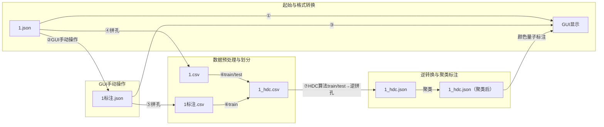

**节点说明**:
1. **①**: 原始1.json直接输出至GUI显示
2. **②**: 通过GUI手动操作，将1.json转为1标注.json
3. **③**: 1标注.json的标注结果保存后输出至GUI显示
4. **④**: 包含拼孔处理，1.json转1.csv
5. **⑤**: 1.csv经train建模预处理后汇入1标注.csv
6. **⑥**: 1标注.csv划分train/test集后生成1_hdc.csv
7. **⑦**: 1_hdc.csv经逆拼孔转为1_hdc.json
8. **⑧**: 1标注.json经拼孔转为1标注.csv

- `encoding`: 经过BeamOffset调整的编码值 (`original_e - beam_offset[channel]`)
- `channel_0-8`: 各通道的声程值 
- `label_0-8`: 各通道对应的伤损类型标签（0=正常，1-19=不同伤损类型，每个通道独立标注）
- `predicted_label_0-8`: HDC模型预测的各通道标签（0=正常，1-19=伤损类型，每个通道独立预测）

-------------------👆原本的----------------------------1.20-------------👇新想的-------------------------------------
encoding 和 channel_0-8 组成1_hdc.csv ，
encoding 和 label_0-8 组成1_label.csv  ,
encoding 和 predicted_label_0-8 组成1_predicted_label.csv .  

   训练的时候使用1_hdc.csv 和1_label.csv 作为输入，窗长为256，步长为(1,9)。
   也就是每次取256*9个编码值和256*9个标签值作为一个样本。矩阵的形状就是(256,9)。
   预测的时候使用1_hdc.csv 窗长为256和模型作为输入，经过hdc算法，输出1_predicted_label.csv。
   也只需要把1_predicted_label.csv转为1_predicted.json即可。别的csv不用转json。

根据original_e=encoding+beam_offset[channel]，可以计算出每个通道的original_e，是否有伤损。生成1_hdc.json

1.json转1.csv具体方案：请用一个函数实现。json只读取一遍。
1. 读取1.json文件，获取所有通道的编码值和声程值。得到1.csv。
2. 读取1.json文件中的BeamOffset比如：
"BeamOffset":[0,35,1,229,2,115,3,175,4,123,5,150,6,20,7,268,8,279]
然后根据BeamOffset，调整original_e，得到调整后的encoding_0-8。保存为1_encoding.csv。
3.找到channel_0-8中最大的那个值，max_e。和最小值min_e。然后从min_e开始，每次增加1，直到max_e。这是encoding的范围。
这时候遍历encoding，保存这个encoding和对应的channel_0-8。保存为1_hdc.csv。
4.读取1标注.json文件，获取original_e后减去对应通道BeamOffset得到encoding，存到对应的通道值里。生成1_label.csv。encoding的范围和1_hdc.csv的范围是一致的。

标准HDC算法通常是每个窗口输出一个标签（单标签分类），因为：HDC将整个窗口编码为一个超向量，超向量与类别中心比较，找到最相似的类别，输出的是整个窗口的类别。所以要逐行扫描每个窗口，找到每个窗口的类别。想要的是每个点的识别结果（矩阵输出），这实际上是点级别的分类，而不是窗口级别的分类。在超声波探伤场景中，这确实更合理，因为：伤损可能只出现在窗口的部分区域，不同位置的伤损类型可能不同，需要精确定位伤损的位置。为了实现正确的输出识别结果，
所以需要设置步长为1 所以(256,9)每次移动(1,9)，训练的时候：中心行的结果就是该窗口的结果，也就是该窗口[127,0-8]的九个结果就是该窗口的结果。要记录通道号 ，所以hdc的类别一共有20种类别*9个通道=180个类别。假如这九个结果中，有一个是1-19，那么就把该窗口的通道号记录为1-19。如果都是0，那么就记录为0。如果有多个非零值就记为多个结果。
或者每个样本运行9次hdc算法，对应生成9个通道模型，该窗口[127,0-8]的九个结果就是9个模型的结果。
在预测时，也是逐行扫描每个窗口，找到每个窗口每个通道的类别。但是要注意的是，预测时的步长也需要设置为1，因为我们需要每个点的识别结果。

- 从距离算相似度 ： 相似度 S = (1 - 2 * 距离 D) * 100%
- 从相似度算距离 ： 距离 D = (1 - 相似度 S / 100) / 2

D为0.476 或0.524 S为94%或96%
