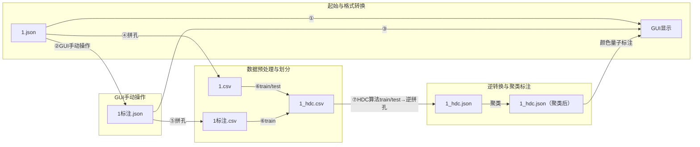

# 超声波HDC探伤系统详细设计文档

## 1. 系统概述

### 1.1 系统简介

超声波HDC探伤系统是一种基于超维计算（Hyperdimensional Computing, HDC）技术的钢轨探伤解决方案，用于检测钢轨中的各种伤损和正常结构。该系统将超声波数据转换为超维向量，通过训练HDC模型实现对钢轨伤损的自动识别和分类。

### 1.2 系统架构

系统采用模块化设计，主要包含以下核心模块：

1. **数据转换模块**（ultrasonic_data_converter.py）：将JSON格式的超声波原始数据转换为CSV格式，用于HDC模型训练和识别
2. **HDC训练模块**（ultrasonic_hdc_emg_style.py）：使用训练数据训练HDC模型，生成超维向量的类别中心
3. **HDC识别模块**（ultrasonic_hdc_emg_style.py）：使用训练好的模型对测试数据进行预测，输出识别结果
4. **结果转换模块**（csv_to_hdc_json.py）：将识别结果转换为可视化的hdc.json格式，用于GUI显示
5. **测试管道模块**（test_channel8_only.py, test_full_pipeline.py）：整合上述模块，实现完整的测试流程
6. **GUI可视化模块**（gui/）：提供B显数据的可视化和标注功能，支持HDC识别结果的可视化展示

## 2. 数据流程设计

### 2.1 完整数据流程

#### 2.1.1 训练数据流程
```
原始JSON文件 (*.json) → 数据转换 → 训练CSV文件 (*.csv) → HDC训练 → 模型文件 (*.pth)
     ↓
标注JSON文件 (*标注.json) → 标注转换 → 训练标签映射
```

#### 2.1.2 测试数据流程
```
原始JSON文件 (*.json) → 数据转换 → 测试CSV文件 (*.csv) → HDC预测 → 预测结果CSV → HDC JSON转换 → 可视化JSON (*.json)
```

#### 2.1.3 文件转换关系
- **原始JSON** (`1.json`) → **训练CSV** (`1.csv`) → **HDC训练** → **模型** (`hdc_model.pth`)
- **原始JSON** (`1.json`) → **测试CSV** (`1.csv`) → **HDC预测** → **预测CSV** (`1_hdc.csv`) → **HDC JSON** (`1_hdc.json`)
- **标注JSON** (`1标注.json`) → **标签映射** (用于训练CSV生成)

### 2.2 BeamOffset处理机制

#### 2.2.1 BeamOffset概念
BeamOffset是拼孔值，用于调整不同通道的X坐标偏置，确保各通道数据正确对齐。BeamOffset和编码值单位都是3mm，所以不需要除以3进行换算。

#### 2.2.2 B显分辨率和坐标计算
- **X轴分辨率**: 3mm（编码值每增加1，对应3mm移动距离）
- **Y轴分辨率**: 1mm（深度值每增加1，对应1mm深度）
- **X坐标计算**: `X = X + b + Δx`，其中b为BeamOffset，Δx为编码值
- **Y坐标计算**: `Y = Ymax * d / 3`，其中d为深度值，Ymax为最大Y坐标

#### 2.2.3 处理流程
1. **数据加载时**：从JSON的`BeamOffset`字段提取各通道的偏置值
2. **坐标计算**：`adjusted_e = original_e + beam_offset[channel]` （BeamOffset和编码值单位都是3mm，直接相加）
3. **深度修正**：考虑水平角和俯仰角的影响
4. **应用时机**：
   - 训练数据转换时应用（生成CSV）
   - 测试数据转换时应用（生成CSV）
   - GUI显示时应用（实时计算显示坐标）

#### 2.2.3 通道映射表（以实际读取数据为准）
根据实际JSON数据格式，以下是标准通道配置：

| 通道 | 角度(°) | 射向 | BeamOffset | BeamWay |
|------|---------|------|------------|---------|
| 0 | 68 | [-1,1] 前外右 | -4 | [-1,1] |
| 1 | 68 | [1,1] 后外右 | 98 | [1,1] |
| 2 | 68 | [-1,-1] 前内右 | 137 | [-1,-1] |
| 3 | 68 | [1,-1] 后内右 | 246 | [1,-1] |
| 4 | 68 | [-1,0] 前直右 | 5 | [-1,0] |
| 5 | 68 | [1,0] 后直右 | -18 | [1,0] |
| 6 | 39 | [-1,0] 前直右 | 115 | [-1,0] |
| 7 | 39 | [1,0] 后直右 | 273 | [1,0] |
| 8 | 0 | [0,0] 直打右 | 257 | [0,0] |

**注**: 实际配置以JSON文件中的`BeamAngle`、`BeamWay`、`BeamOffset`为准

## 2. 功能需求

### 2.1 数据转换功能

| 功能编号 | 功能名称 | 功能描述 | 输入 | 输出 | 实现模块 |
|---------|---------|---------|------|------|---------|
| FR-001 | JSON转CSV | 将JSON格式的超声波原始数据转换为CSV格式，应用BeamOffset调整E值，用于HDC模型训练和识别 | JSON文件路径，标注文件路径（可选） | CSV文件（包含adjusted_e） | ultrasonic_data_converter.py |
| FR-002 | 批量数据转换 | 批量转换目录中的所有JSON文件，自动匹配标注文件 | 数据目录路径，输出目录路径 | 多个CSV文件 | ultrasonic_data_converter.py |
| FR-003 | 提取伤损区域 | 从标注数据中提取伤损区域，生成E值到标签的映射，考虑BeamOffset调整 | 标注文件，BeamOffset数据 | E值到标签的映射字典 | ultrasonic_data_converter.py |
| FR-004 | 创建滑动窗口 | 从E值数据中创建滑动窗口样本，用于HDC模型训练，窗口内点共享同一标签 | E值数据，窗口大小，滑动步长 | 滑动窗口样本列表 | ultrasonic_data_converter.py |

### 2.2 HDC训练功能

| 功能编号 | 功能名称 | 功能描述 | 输入 | 输出 | 实现模块 |
|---------|---------|---------|------|------|---------|
| FR-010 | 数据集加载 | 加载CSV格式的训练数据，生成滑动窗口样本 | 数据目录路径 | 训练数据集 | ultrasonic_hdc_emg_style.py |
| FR-011 | 超维编码 | 将时序信号转换为超维向量，捕获信号的时序和通道关系 | 滑动窗口样本 | 超维向量 | ultrasonic_hdc_emg_style.py |
| FR-012 | 模型训练 | 使用超维向量训练HDC模型，生成类别中心 | 超维向量，标签 | 训练好的HDC模型 | ultrasonic_hdc_emg_style.py |
| FR-013 | 模型保存 | 将训练好的模型保存到文件，用于后续识别 | 训练好的HDC模型 | 模型文件 | ultrasonic_hdc_emg_style.py |

### 2.3 HDC识别功能

| 功能编号 | 功能名称 | 功能描述 | 输入 | 输出 | 实现模块 |
|---------|---------|---------|------|------|---------|
| FR-020 | 模型加载 | 加载训练好的HDC模型，用于识别 | 模型文件路径 | 训练好的HDC模型 | ultrasonic_hdc_emg_style.py |
| FR-021 | 测试数据加载 | 加载CSV格式的测试数据，生成滑动窗口样本 | 数据目录路径 | 测试数据集 | ultrasonic_hdc_emg_style.py |
| FR-022 | 超维向量生成 | 将测试数据转换为超维向量 | 滑动窗口样本 | 超维向量 | ultrasonic_hdc_emg_style.py |
| FR-023 | 模型预测 | 使用HDC模型对超维向量进行分类，输出预测结果 | 超维向量 | 预测标签 | ultrasonic_hdc_emg_style.py |
| FR-024 | 预测结果保存 | 将预测结果保存到CSV文件，包含原始数据和预测标签 | 测试数据，预测标签 | 带预测结果的CSV文件 | ultrasonic_hdc_emg_style.py |

### 2.4 结果转换功能

| 功能编号 | 功能名称 | 功能描述 | 输入 | 输出 | 实现模块 |
|---------|---------|---------|------|------|---------|
| FR-030 | CSV转hdc.json | 将带预测结果的CSV文件转换为hdc.json格式，用于GUI显示 | 带预测结果的CSV文件 | hdc.json文件 | csv_to_hdc_json.py |
| FR-031 | 缺陷点提取 | 从CSV文件中提取缺陷点（predicted_label_0-8不为0的点，支持单通道和多通道模式） | CSV文件 | 缺陷点DataFrame | csv_to_hdc_json.py |
| FR-032 | 点聚类 | 使用DBSCAN算法将同一目标的缺陷点归为一个簇 | 缺陷点DataFrame | 带簇标签的缺陷点DataFrame | csv_to_hdc_json.py |
| FR-033 | 批量结果转换 | 批量转换目录中的所有CSV文件 | 输入目录路径 | 多个hdc.json文件 | csv_to_hdc_json.py |

### 2.5 测试管道功能

| 功能编号 | 功能名称 | 功能描述 | 输入 | 输出 | 实现模块 |
|---------|---------|---------|------|------|---------|
| FR-040 | 完整测试流程 | 整合数据转换、模型训练、模型识别和结果转换模块，实现完整的测试流程 | 训练数据目录，测试数据目录 | 测试结果，hdc.json文件 | test_full_pipeline.py |
| FR-041 | 准确率测试 | 测试不同配置下模型的准确率，生成测试报告 | 训练数据目录，测试数据目录 | 准确率测试结果 | test_full_pipeline.py |
| FR-042 | 旧文件清理 | 清理目录中旧的hdc.json和hdc.csv文件，避免文件累积 | 数据目录列表 | 清理结果 | test_full_pipeline.py |

### 2.6 GUI可视化功能

| 功能编号 | 功能名称 | 功能描述 | 输入 | 输出 | 实现模块 |
|---------|---------|---------|------|------|---------|
| FR-050 | 数据可视化 | 可视化显示超声波B显数据，支持不同通道、显示模式的切换 | JSON文件路径 | B显可视化界面 | gui/main_window.py |
| FR-051 | 标注创建 | 创建新的标注，包括选择标注类型、选择标注点、保存标注 | 选择的标注类型，选择的点 | 标注数据 | gui/annotation_manager.py |
| FR-052 | 标注加载 | 加载已有的标注数据，显示在可视化界面上 | 标注文件路径 | 标注显示 | gui/annotation_manager.py |
| FR-053 | 标注保存 | 将当前标注数据保存到文件 | 标注文件路径 | 保存成功提示 | gui/annotation_manager.py |
| FR-054 | 标注删除 | 删除选定的标注 | 标注ID | 标注删除成功提示 | gui/annotation_manager.py |
| FR-055 | 类型选择 | 提供标注类型选择对话框，支持伤损和结构类型的选择 | 用户选择 | 选择的标注类型 | gui/type_selector.py |
| FR-056 | 点选择 | 支持在可视化界面上选择点，用于创建标注 | 鼠标点击选择 | 选中的点列表 | gui/point_selector.py |
| FR-057 | HDC结果可视化 | 可视化显示HDC识别结果，支持与手动标注的区分显示 | hdc.json文件 | HDC结果可视化界面 | gui/main_window.py |
| FR-058 | 文件操作 | 支持打开、保存、关闭等文件操作 | 文件路径 | 文件操作结果 | gui/main_window.py |
| FR-059 | 参数配置 | 支持调整可视化参数，如显示模式、通道选择、缩放比例等 | 用户配置 | 配置更新 | gui/main_window.py |

## 3. 非功能需求

### 3.1 性能需求

| 非功能编号 | 需求名称 | 需求描述 | 实现模块 |
|-----------|---------|---------|---------|
| NFR-001 | 数据转换速度 | 单个JSON文件转换时间不超过5秒 | ultrasonic_data_converter.py |
| NFR-002 | 模型训练时间 | 训练时间不超过30分钟（基于10000维超向量） | ultrasonic_hdc_emg_style.py |
| NFR-003 | 模型识别速度 | 单个测试文件识别时间不超过10秒 | ultrasonic_hdc_emg_style.py |
| NFR-004 | 批量处理效率 | 批量处理100个文件的时间不超过10分钟 | 所有模块 |

### 3.2 可靠性需求

| 非功能编号 | 需求名称 | 需求描述 | 实现模块 |
|-----------|---------|---------|---------|
| NFR-010 | 异常处理 | 系统应能处理文件不存在、格式错误等异常情况，不崩溃 | 所有模块 |
| NFR-011 | 容错性 | 单个文件处理失败不应影响整个批量处理过程 | 所有模块 |
| NFR-012 | 数据完整性 | 转换和识别过程应保持数据完整性，不丢失关键信息 | 所有模块 |

### 3.3 可维护性需求

| 非功能编号 | 需求名称 | 需求描述 | 实现模块 |
|-----------|---------|---------|---------|
| NFR-020 | 代码模块化 | 代码应采用模块化设计，便于维护和扩展 | 所有模块 |
| NFR-021 | 代码可读性 | 代码应具有良好的注释和命名规范，便于理解和修改 | 所有模块 |
| NFR-022 | 配置可调节 | 关键参数（如窗口大小、超向量维度等）应可通过配置文件或命令行参数调节 | 所有模块 |

### 3.4 可扩展性需求

| 非功能编号 | 需求名称 | 需求描述 | 实现模块 |
|-----------|---------|---------|---------|
| NFR-030 | 新伤损类型支持 | 系统应支持添加新的伤损类型，无需修改核心代码 | ultrasonic_data_converter.py, csv_to_hdc_json.py |
| NFR-031 | 新数据格式支持 | 系统应支持扩展以处理新的超声波数据格式 | ultrasonic_data_converter.py |
| NFR-032 | GUI组件扩展 | GUI模块应支持添加新的可视化组件和功能 | gui/main_window.py |
| NFR-033 | 新标注类型支持 | GUI模块应支持添加新的标注类型，无需修改核心代码 | gui/type_selector.py |

## 4. 技术指标

| 技术指标编号 | 指标名称 | 指标值 | 实现模块 |
|-------------|---------|-------|---------|
| TI-001 | 通道数量 | 9个通道（0-8） | 所有模块 |
| TI-002 | 超向量维度 | 10000维 | ultrasonic_hdc_emg_style.py |
| TI-003 | 窗口大小 | 128（可配置） | ultrasonic_hdc_emg_style.py |
| TI-004 | 滑动步长 | 64（可配置） | ultrasonic_hdc_emg_style.py |
| TI-005 | N-gram大小 | 4（可配置） | ultrasonic_hdc_emg_style.py |
| TI-006 | 识别准确率 | 不低于85% | ultrasonic_hdc_emg_style.py |
| TI-007 | 通道映射 | 0-8直接映射，不使用额外映射 | 所有模块 |
| TI-008 | 点聚类算法 | DBSCAN，eps=5.0，min_samples=5（可配置） | csv_to_hdc_json.py |
| TI-009 | 可视化支持格式 | JSON数组、JSON Lines、单行JSON | gui/main_window.py |
| TI-010 | 标注格式支持 | 支持自定义标注格式，兼容hdc.json格式 | gui/annotation_manager.py |
| TI-011 | 可视化帧率 | 不低于30帧/秒 | gui/main_window.py |
| TI-012 | 标注类型支持 | 支持14种伤损类型和9种结构类型 | gui/type_selector.py |
| TI-013 | 可视化显示模式 | 支持原始声程、实际深度、二次反射等多种显示模式 | gui/main_window.py |

## 5. 数据格式设计

### 5.1 输入数据格式

#### 5.1.1 JSON数据格式

```json
[
  {
    "E": 1,
    "BeamOffset": [0, 0, 1, 10, 2, 20, ...]  // 配置信息
  },
  {
    "E": 100,
    "B1": [0, 10, 100, 0, 0]  // [通道, 深度, 振幅, dB值, ...]
  },
  ...
]
```

#### 5.1.2 标注数据格式

```json
{
  "annotations": [
    {
      "id": "1",
      "type": "伤损",
      "subtype": {
        "id": "1",
        "name": "轨头外侧核伤"
      },
      "points": [
        {
          "e": 592,
          "channel": 6,
          "depth": 90.0,
          "amplitude": 100.0
        },
        ...
      ]
    },
    ...
  ]
}
```

### 5.2 中间数据格式

#### 5.2.1 原始CSV数据格式（训练用）

**文件名模式**: `{原始文件名}.csv` (如: `1.csv`)

| encoding | channel_0 | channel_1 | channel_2 | channel_3 | channel_4 | channel_5 | channel_6 | channel_7 | channel_8 | label_0 | label_1 | label_2 | label_3 | label_4 | label_5 | label_6 | label_7 | label_8 |
|---------|-----------|-----------|-----------|-----------|-----------|-----------|-----------|-----------|-----------|---------|---------|---------|---------|---------|---------|---------|---------|---------|
| 2 | 0.0 | 0.0 | 0.0 | 0.0 | 0.0 | 0.0 | 0.0 | 0.0 | 192.0 | 0 | 0 | 0 | 0 | 0 | 0 | 0 | 0 | 0 |
| 3 | 0.0 | 0.0 | 0.0 | 0.0 | 0.0 | 0.0 | 0.0 | 0.0 | 192.0 | 0 | 0 | 0 | 0 | 0 | 0 | 0 | 0 | 0 |
| ... | ... | ... | ... | ... | ... | ... | ... | ... | ... | ... | ... | ... | ... | ... | ... | ... | ... | ... |

**字段说明**:
- `encoding`: 经过BeamOffset调整的编码值 (`original_e + beam_offset[channel]`)
- `channel_0-8`: 各通道的幅度值（深度值）
- `label_0-8`: 各通道对应的伤损类型标签（0=正常，1-19=不同伤损类型，每个通道独立标注）

#### 5.2.2 带预测结果的CSV格式

**文件名模式**: `{原始文件名}_hdc.csv` (如: `1_hdc.csv`)

| encoding | channel_0 | channel_1 | channel_2 | channel_3 | channel_4 | channel_5 | channel_6 | channel_7 | channel_8 | label_0 | label_1 | label_2 | label_3 | label_4 | label_5 | label_6 | label_7 | label_8 | predicted_label_0 | predicted_label_1 | predicted_label_2 | predicted_label_3 | predicted_label_4 | predicted_label_5 | predicted_label_6 | predicted_label_7 | predicted_label_8 |
|---------|-----------|-----------|-----------|-----------|-----------|-----------|-----------|-----------|-----------|---------|---------|---------|---------|---------|---------|---------|---------|---------|------------------|------------------|------------------|------------------|------------------|------------------|------------------|------------------|------------------|
| 2 | 0.0 | 0.0 | 0.0 | 0.0 | 0.0 | 0.0 | 0.0 | 0.0 | 192.0 | 0 | 0 | 0 | 0 | 0 | 0 | 0 | 0 | 0 | 0 | 0 | 0 | 0 | 0 | 0 | 13 | 13 | 13 |
| 3 | 0.0 | 0.0 | 0.0 | 0.0 | 0.0 | 0.0 | 0.0 | 0.0 | 192.0 | 0 | 0 | 0 | 0 | 0 | 0 | 0 | 0 | 0 | 0 | 0 | 0 | 0 | 0 | 0 | 13 | 13 | 13 |
| ... | ... | ... | ... | ... | ... | ... | ... | ... | ... | ... | ... | ... | ... | ... | ... | ... | ... | ... | ... | ... | ... | ... | ... | ... | ... | ... | ... |

**字段说明**:
- `encoding`: 经过BeamOffset调整的编码值
- `channel_0-8`: 各通道的幅度值
- `label_0-8`: 原始标签（测试数据可能为0或从标注文件获取）
- `predicted_label_0-8`: HDC模型预测的各通道标签（0=正常，1-19=伤损类型，每个通道独立预测）

#### 5.2.3 HDC滑动窗口样本格式

**内存中的数据结构**（用于HDC编码）:

```python
# 单个样本格式 [batch_size, window_size, channels]
sample = torch.tensor([
    [  # 窗口1: encoding=100-135
        [10.0, 0.0, 0.0, 0.0, 0.0, 0.0, 0.0, 0.0, 0.0],  # channel_0-8 at encoding=100
        [11.0, 0.0, 0.0, 0.0, 0.0, 0.0, 0.0, 0.0, 0.0],  # channel_0-8 at encoding=101
        # ... 其他encoding
        [15.0, 0.0, 0.0, 0.0, 0.0, 0.0, 0.0, 0.0, 0.0],  # channel_0-8 at encoding=135
    ]
], dtype=torch.float32)

# 对应标签
label = 1  # 该窗口的伤损类型标签
```

**窗口生成规则**:
- 窗口大小: 36个编码值（可配置）
- 滑动步长: 18个编码值（可配置）
- 标签确定: 窗口内出现最多的标签作为窗口标签
- 多通道处理: 每个通道独立处理，标签为多通道数组

### 5.3 输出数据格式

#### 5.3.1 标注数据和HDC结果JSON格式

**标注数据格式**（手动标注或HDC预测）:

```json
{
  "annotations": [
    {
      "id": "1",
      "type": "伤损",
      "subtype": {
        "id": "1",
        "name": "轨头外侧核伤"
      },
      "points": [
        {
          "e": 592,
          "channel": 6,
          "depth": 90.0,
          "amplitude": 100.0
        }
      ],
      "start_E": 592,
      "end_E": 592,
      "channels": [6],
      "timestamp": "2026-01-15T12:00:00",
      "source": "manual"  // 手动标注
    },
    {
      "id": "1000",
      "type": "伤损",
      "subtype": {
        "id": "1",
        "name": "HDC识别伤损"
      },
      "points": [
        {
          "e": 592,
          "channel": 6,
          "depth": 90.0,
          "amplitude": 100.0
        }
      ],
      "start_E": 592,
      "end_E": 600,
      "channels": [6],
      "timestamp": "2026-01-15T12:00:00",
      "source": "predicted"  // HDC预测结果
    }
  ]
}
```

**标注数据vs HDC标注数据的区别**:
- `source`: "manual"（手动标注） vs "predicted"（HDC算法预测）
- 其他字段格式完全相同，便于GUI统一处理

## 6. 核心算法设计

### 6.1 HDC编码算法

#### 6.1.1 编码参数
- **超向量维度**: 10000维
- **Level嵌入级别**: 255级（适应0-255的幅度值范围）
- **通道数量**: 9个通道（0-8）
- **N-gram大小**: 4（可配置，捕获时序关系）

#### 6.1.2 编码流程
1. **通道嵌入初始化**：
   ```python
   # 为9个通道创建随机超向量
   channels = embeddings.Random(9, 10000)  # [9, 10000]
   ```

2. **信号嵌入初始化**：
   ```python
   # Level嵌入处理连续幅度值
   signals = embeddings.Level(255, 10000, high=20)  # high值根据实际数据调整
   ```

3. **单样本编码过程**：
   ```python
   # 输入: [window_size, channels] = [36, 9]
   # 步骤1: 信号嵌入
   signal_hvs = signals(input)  # [36, 9, 10000]

   # 步骤2: 通道绑定
   channel_hvs = channels.weight.unsqueeze(0)  # [1, 9, 10000]
   bound_hvs = torchhd.bind(signal_hvs, channel_hvs)  # [36, 9, 10000]

   # 步骤3: 通道聚合 (multiset)
   sample_hv = torchhd.multiset(bound_hvs)  # [36, 10000]

   # 步骤4: 时序关系捕获 (n-gram)
   final_hv = torchhd.ngrams(sample_hv, n=4)  # [33, 10000]

   # 步骤5: 硬量化
   quantized_hv = torchhd.hard_quantize(final_hv)  # [33, 10000]
   ```

#### 6.1.3 通道8专用编码（test_channel8_only.py）
```python
class Channel8Encoder(nn.Module):
    def __init__(self, out_features, timestamps, n_gram_size=15):
        super().__init__()
        self.channels = embeddings.Random(1, out_features)  # 只使用1个通道
        self.signals = embeddings.Level(255, out_features, high=255)
        self.n_gram_size = n_gram_size

    def forward(self, input):  # input: [batch, timestamps, 1]
        signal = self.signals(input)
        channel_hv = self.channels.weight.unsqueeze(0).unsqueeze(0)
        samples = torchhd.bind(signal, channel_hv)
        samples = torchhd.multiset(samples)
        sample_hv = torchhd.ngrams(samples, n=self.n_gram_size)
        return torchhd.hard_quantize(sample_hv)
```

### 6.2 模型训练算法

#### 6.2.1 训练数据准备
1. **加载训练CSV**：从`data/train/`目录读取所有`.csv`文件
2. **滑动窗口生成**：
   - 窗口大小: 36
   - 滑动步长: 18
   - 为每个窗口确定标签（窗口内多数标签）
3. **数据平衡检查**：统计各标签分布

#### 6.2.1 标签处理机制

**训练时标签的作用**:
- 标签用于指导HDC模型学习，将相似的数据样本聚集到超维空间的相同区域
- 每个通道独立建模，标签表示该通道在该位置是否有伤损（0=正常，1-19=伤损类型）
- 标签不作为算法的输入特征，而是作为监督学习的"教师信号"
- 通道0-8都有对应的手动标注标签和预测标签

**测试时标签的处理**:
- 测试数据没有真实标签（因为这是要预测的内容）
- 模型根据学习到的模式进行预测，输出每个通道的预测标签
- 预测结果用于生成可视化的HDC标注

#### 6.2.2 多通道训练流程
```python
def train_model():
    # 1. 加载训练数据（包含标签）
    train_ds = UltrasonicDataset(TRAIN_DIR, is_train=True)  # 加载带有标签的CSV数据
    train_ld = data.DataLoader(train_ds, batch_size=1, shuffle=True)

    # 2. 确定类别数（基于训练数据的标签分布）
    all_labels = []
    for label in train_ds.labels:
        all_labels.extend(label)
    num_classes = max(all_labels) + 1

    # 3. 初始化编码器和9个模型
    encode = Encoder(DIMENSIONS=10000, timestamps=WINDOW, channels=9, n_gram_size=4)
    models = [Centroid(10000, num_classes) for _ in range(9)]  # 9个通道的模型

    # 4. 训练过程：使用标签指导模型学习
    with torch.no_grad():
        for samples, targets in train_ld:  # samples: [1, WINDOW, 9], targets: [9]
            sample_hv = encode(samples)  # 将超声信号编码为超维向量 [1, 10000]
            for channel in range(9):
                channel_target = targets[channel].long()  # 该通道的真实标签
                models[channel].add(sample_hv, channel_target)  # 根据标签聚集超维向量

    # 5. 模型归一化
    for model in models:
        model.normalize()

    # 6. 保存模型
    torch.save({
        'encoder_state_dict': encode.state_dict(),
        'model_state_dicts': [m.state_dict() for m in models],
        'num_classes': num_classes,
        'sample_shape': (WINDOW, 9),
        'n_gram_size': 4,
        'is_multichannel': True
    }, MODEL_PATH)
```

#### 6.2.3 通道8专用训练流程
```python
def train_channel8_model():
    # 1. 加载通道8数据
    train_ds = Channel8Dataset(TRAIN_DATA_DIR, is_train=True)
    train_ld = data.DataLoader(train_ds, batch_size=1, shuffle=True)

    # 2. 初始化编码器和模型
    encode = Channel8Encoder(DIMENSIONS=10000, timestamps=32, n_gram_size=15)
    model = Centroid(10000, num_classes=20)

    # 3. 训练过程
    with torch.no_grad():
        for samples, targets in train_ld:  # samples: [1, 32, 1]
            sample_hv = encode(samples)  # [1, 10000]
            model.add(sample_hv, targets)

    # 4. 保存模型
    torch.save({
        'encoder_state_dict': encode.state_dict(),
        'model_state_dict': model.state_dict(),
        'num_classes': 20,
        'sample_shape': (32, 1),
        'n_gram_size': 15
    }, MODEL_PATH)
```

### 6.3 模型识别算法

#### 6.3.1 测试数据准备
1. **加载测试CSV**：从`data/test/`目录读取`.csv`文件
2. **滑动窗口生成**：与训练时使用相同参数
3. **保持文件信息**：记录每个样本对应的文件和窗口位置

#### 6.3.2 多通道识别流程
```python
def predict_model():
    # 1. 加载模型
    checkpoint = torch.load(MODEL_PATH)
    encode = Encoder(10000, 36, 9, n_gram_size=4)
    encode.load_state_dict(checkpoint['encoder_state_dict'])
    models = [Centroid(10000, checkpoint['num_classes']) for _ in range(9)]
    for i, state_dict in enumerate(checkpoint['model_state_dicts']):
        models[i].load_state_dict(state_dict)

    # 2. 加载测试数据
    test_ds = UltrasonicDataset(TEST_DIR, is_train=False)
    test_ld = data.DataLoader(test_ds, batch_size=1, shuffle=False)

    # 3. 预测过程
    predictions = []
    with torch.no_grad():
        for samples, _ in test_ld:
            sample_hv = encode(samples)
            pred_labels = []
            for channel in range(9):
                output = models[channel](sample_hv, dot=True)
                pred_label = torch.argmax(output, dim=1).item()
                pred_labels.append(pred_label)
            predictions.append(pred_labels)

    # 4. 保存预测结果到CSV
    save_predictions_to_csv(predictions, test_ds.file_info)
```

#### 6.3.3 通道8专用识别流程
```python
def predict_channel8_model():
    # 1. 加载模型
    checkpoint = torch.load(MODEL_PATH)
    encode = Channel8Encoder(10000, 32, n_gram_size=15)
    encode.load_state_dict(checkpoint['encoder_state_dict'])
    model = Centroid(10000, checkpoint['num_classes'])
    model.load_state_dict(checkpoint['model_state_dict'])

    # 2. 预测过程
    predictions = []
    with torch.no_grad():
        for samples, _ in test_ld:
            sample_hv = encode(samples)
            output = model(sample_hv, dot=True)
            pred_label = torch.argmax(output, dim=1).item()
            predictions.append(pred_label)

    # 5. 只在窗口中心点标记预测结果（减少误报）
    for idx, pred_label in enumerate(predictions):
        file_path, start, end = test_ds.file_info[idx]
        center = (start + end) // 2
        # 只在中心点设置predicted_label_8
        df.loc[df['encoding'] == center, 'predicted_label_8'] = pred_label
```

#### 6.3.4 训练vs测试的区别
| 阶段 | 数据来源 | 标签处理 | 输出 |
|------|---------|----------|------|
| 训练 | `data/train/*.csv` | 使用真实标签训练模型 | 模型文件(`.pth`) |
| 测试 | `data/test/*.csv` | 忽略原始标签，只用模型预测 | 预测结果CSV + HDC JSON |

### 6.4 评价指标体系

#### 6.4.1 探伤场景核心指标

**F1分数 (F1-Score)**: 精准率和召回率的调和平均数
- **精准率 (Precision)**: TP/(TP+FP) - 模型判断为有缺陷的样本中，真正有缺陷的比例
- **召回率 (Recall)**: TP/(TP+FN) - 实际有缺陷的样本中，被模型正确识别的比例
- **F1公式**: 2×Precision×Recall/(Precision+Recall)

**Fβ分数 (F-beta Score)**: 召回率加权调和平均数
- **β=2**: F2分数，召回率权重是精准率的2倍（探伤首选指标）
- **适用场景**: 漏检代价远大于误判时使用

**马修斯相关系数 (MCC)**: 最公平的二分类评价指标
- **取值范围**: -1到1，1表示完美，0表示随机猜，-1表示完全相反
- **优势**: 对样本不平衡不敏感，能真实反映模型性能

**漏检率 (FNR)**: 一票否决指标
- **计算**: FN/(TP+FN) - 实际有缺陷但未被识别的比例
- **目标**: ≤1%（漏检率不能超过1%）

#### 6.4.2 指标优先级
1. **第一梯队 (必须用，缺一不可)**:
   - F2分数 ≥0.85
   - MCC ≥0.85
   - 漏检率 ≤0.01

2. **第二梯队 (辅助评估)**:
   - PR-AUC ≥0.9
   - ROC-AUC ≥0.95
   - 误报率 ≤0.05

3. **第三梯队 (按需使用)**:
   - 准确率 (Accuracy)
   - Kappa系数
   - LogLoss

### 6.5 点聚类算法

#### 6.5.1 缺陷点提取
```python
def extract_defect_points(csv_file, target_channel=None):
    """从CSV文件中提取缺陷点（predicted_label != 0的点）"""
    df = pd.read_csv(csv_file)

    if target_channel is not None:
        # 单通道模式（如channel8）
        label_col = f'predicted_label_{target_channel}'
        if label_col not in df.columns:
            return np.array([]), pd.DataFrame()

        defect_df = df[df[label_col] != 0].copy()
        features = []

        for _, row in defect_df.iterrows():
            encoding = row['encoding']
            amplitude = row[f'channel_{target_channel}']
            if amplitude > 0:  # 只处理有信号的点
                features.append([encoding, target_channel, amplitude])

        return np.array(features), defect_df
    else:
        # 多通道模式
        defect_points = []
        defect_df = pd.DataFrame()

        for ch in range(9):
            label_col = f'predicted_label_{ch}'
            if label_col in df.columns:
                ch_defects = df[df[label_col] != 0].copy()
                ch_defects['defect_channel'] = ch

                for _, row in ch_defects.iterrows():
                    encoding = row['encoding']
                    amplitude = row[f'channel_{ch}']
                    if amplitude > 0:
                        defect_points.append([encoding, ch, amplitude])

                defect_df = pd.concat([defect_df, ch_defects])

        return np.array(defect_points), defect_df
```

#### 6.4.2 DBSCAN聚类参数
- **eps**: 5.0（邻域半径）
- **min_samples**: 5（最小样本数）
- **特征**: [编码值, 通道号, 幅度值]

#### 6.4.3 聚类结果处理
```python
def cluster_points(features):
    from sklearn.cluster import DBSCAN

    # 执行DBSCAN聚类
    dbscan = DBSCAN(eps=5.0, min_samples=5)
    clusters = dbscan.fit_predict(features)

    # 处理聚类结果
    valid_clusters = []
    for cluster_id in np.unique(clusters):
        if cluster_id == -1:  # 跳过噪声点
            continue

        cluster_points = features[clusters == cluster_id]
        if len(cluster_points) >= 3:  # 只保留点数>=3的簇
            valid_clusters.append(cluster_points)

    return valid_clusters
```

#### 6.4.4 HDC JSON生成
```python
def generate_hdc_json(defect_clusters, original_csv_file):
    """生成HDC识别结果的JSON格式"""
    annotations = []

    for i, cluster in enumerate(defect_clusters):
        # 计算簇的边界
        min_e = cluster[:, 0].min()
        max_e = cluster[:, 0].max()
        channels = sorted(list(set(cluster[:, 1].astype(int))))

        # 创建标注
        annotation = {
            "id": str(1000 + i),
            "type": "伤损",
            "subtype": {"id": "1", "name": "HDC识别伤损"},
            "points": [],
            "start_E": int(min_e),
            "end_E": int(max_e),
            "channels": channels,
            "timestamp": datetime.now().isoformat(),
            "source": "hdc_prediction"  # 标记为HDC预测结果
        }

        # 添加簇中的点
        for point in cluster:
            annotation["points"].append({
                "e": int(point[0]),
                "channel": int(point[1]),
                "depth": float(point[2]),  # 使用幅度作为深度
                "amplitude": float(point[2])
            })

        annotations.append(annotation)

    return {"annotations": annotations}
```

### 6.5 GUI数据解析与可视化算法

#### 6.5.1 JSON数据解析算法

```python
class FlawDetectionDataParser:
    def _load_json(self) -> List[Dict]:
        """支持多种JSON格式的加载"""
        with open(self.json_file, 'r', encoding='utf-8') as f:
            content = f.read().strip()

        # 尝试不同的JSON格式
        try:
            # 格式1: JSON数组
            if content.startswith('['):
                return json.loads(content)
            # 格式2: JSON Lines
            elif '\n' in content:
                return [json.loads(line) for line in content.split('\n') if line.strip()]
            # 格式3: 单行JSON对象
            else:
                data = json.loads(content)
                return [data] if isinstance(data, dict) else data
        except json.JSONDecodeError:
            raise ValueError("不支持的JSON格式")
```

#### 6.5.2 BeamOffset处理算法

```python
def apply_beam_offset(self, e_value: int, channel: int) -> int:
    """应用BeamOffset调整编码值

    Args:
        e_value: 原始编码值
        channel: 通道号

    Returns:
        调整后的编码值
    """
    if hasattr(self, 'beam_offset') and self.beam_offset:
        offset = self.beam_offset.get(channel, 0)
        # BeamOffset的处理: BeamOffset和编码值单位都是3mm，直接相加
        return e_value + offset
    return e_value
```

#### 6.5.3 深度计算算法

```python
def calculate_adjusted_depth(self, channel: int, depth: float, display_mode: str) -> float:
    """计算调整后的深度，考虑角度和显示模式

    Args:
        channel: 通道号
        depth: 原始深度值
        display_mode: 显示模式 ('V型', '实际深度', '二次反射')

    Returns:
        调整后的深度值
    """
    # 获取通道的角度信息
    angles = self.get_channel_angles()

    if display_mode == "V型":
        # V型显示：depth * cos(angle)
        angle_rad = np.radians(angles.get(channel, 0))
        return depth * np.cos(angle_rad)
    elif display_mode == "实际深度":
        # 实际深度：考虑水平角和俯仰角
        horizontal_angle = angles.get(channel, 0)
        elevation_angle = 0  # 假设俯仰角为0
        angle_rad = np.radians(horizontal_angle)
        elevation_rad = np.radians(elevation_angle)
        return depth * np.cos(angle_rad) * np.cos(elevation_rad)
    elif display_mode == "二次反射":
        # 二次反射：特殊处理
        return self.calculate_secondary_reflection_depth(channel, depth)
    else:
        return depth
```

#### 6.5.4 B显点可视化算法

```python
def draw_bscan_points(self, ax, display_range=None, display_mode="V型"):
    """绘制B显点

    Args:
        ax: matplotlib轴对象
        display_range: 显示的编码值范围 (start_e, end_e)
        display_mode: 显示模式
    """
    # 1. 提取B显点数据
    bscan_points = self.extract_bscan_points()

    # 2. 应用显示范围过滤
    if display_range:
        start_e, end_e = display_range
        bscan_points = [p for p in bscan_points if start_e <= p['e'] <= end_e]

    # 3. 按通道分组绘制
    channel_colors = self.get_channel_colors()
    for channel in range(9):
        channel_points = [p for p in bscan_points if p['channel'] == channel]

        if not channel_points:
            continue

        # 应用BeamOffset和深度调整
        x_coords = []
        y_coords = []
        amplitudes = []

        for point in channel_points:
            adjusted_e = self.apply_beam_offset(point['e'], channel)
            adjusted_depth = self.calculate_adjusted_depth(
                channel, point['depth'], display_mode
            )

            x_coords.append(adjusted_e)
            y_coords.append(adjusted_depth)
            amplitudes.append(point['amplitude'])

        # 根据幅度设置点大小和颜色
        sizes = [max(1, amp * 50) for amp in amplitudes]  # 幅度映射到点大小
        colors = [channel_colors[channel] for _ in channel_points]

        ax.scatter(x_coords, y_coords, s=sizes, c=colors, alpha=0.7)
```

#### 6.5.5 点选择算法

```python
class PointSelector:
    def select_single_point(self, x, y):
        """选择单个点"""
        closest_point = None
        min_distance = float('inf')

        for point in self.canvas.displayed_points:
            # 计算鼠标位置到点的距离
            distance = np.sqrt((point['x'] - x)**2 + (point['y'] - y)**2)
            if distance < min_distance and distance < self.threshold:
                min_distance = distance
                closest_point = point

        if closest_point:
            self.selected_points.append(closest_point)
            self.highlight_selected_points()
            return True
        return False

    def select_points_by_rect(self, x1, y1, x2, y2, add_points=True):
        """矩形框选点"""
        selected = []
        for point in self.canvas.displayed_points:
            if (min(x1, x2) <= point['x'] <= max(x1, x2) and
                min(y1, y2) <= point['y'] <= max(y1, y2)):
                selected.append(point)

        if add_points:
            self.selected_points.extend(selected)
        else:
            self.selected_points = selected

        self.highlight_selected_points()
        return len(selected) > 0
```

#### 6.5.6 标注管理算法

```python
class AnnotationManager:
    def create_annotation(self, annotation_type, subtype, points):
        """创建标注"""
        if not points:
            return None

        # 按编码值排序
        sorted_points = sorted(points, key=lambda p: p['e'])

        # 计算范围和通道
        start_e = sorted_points[0]['e']
        end_e = sorted_points[-1]['e']
        channels = sorted(list(set(p['channel'] for p in sorted_points)))

        # 创建标注对象
        annotation = {
            "id": str(self.annotation_id),
            "type": annotation_type,
            "subtype": subtype,
            "points": sorted_points,
            "start_E": start_e,
            "end_E": end_e,
            "channels": channels,
            "timestamp": datetime.now().isoformat()
        }

        self.annotations.append(annotation)
        self.annotation_id += 1
        return annotation
```

## 7. 模块详细设计

### 7.1 数据转换模块（ultrasonic_data_converter.py）

#### 7.1.1 核心功能流程

**单个文件转换流程**:
```python
def convert_single_file(json_file, annotation_file=None, output_csv=None):
    # 1. 加载原始JSON数据
    json_data = load_json_data(json_file)

    # 2. 提取BeamOffset
    beam_offset = extract_beam_offset(json_data)

    # 3. 加载标注数据（如果有）
    annotation_data = None
    if annotation_file and os.path.exists(annotation_file):
        annotation_data = load_annotation_data(annotation_file)

    # 4. 提取B显数据，按E值组织
    bscan_data = extract_bscan_data(json_data)

    # 5. 应用BeamOffset调整E值
    adjusted_bscan_data = apply_beam_offset_to_bscan(bscan_data, beam_offset)

    # 6. 生成标签映射（如果有标注）
    label_mapping = None
    if annotation_data:
        label_mapping = create_label_mapping(annotation_data, beam_offset)

    # 7. 转换为CSV格式
    csv_data = convert_to_csv_format(adjusted_bscan_data, label_mapping)

    # 8. 保存CSV文件
    save_csv_file(csv_data, output_csv)
```

#### 7.1.2 BeamOffset处理细节

```python
def apply_beam_offset_to_bscan(bscan_data, beam_offset):
    """应用BeamOffset调整所有B显点的E值"""
    adjusted_data = {}

    for e_value, points in bscan_data.items():
        adjusted_e = e_value  # 默认值

        # 找到该E值上的所有点，确定主要通道
        channels_in_e = set()
        for point in points:
            channels_in_e.add(point['channel'])

        # 对每个通道应用BeamOffset
        for channel in channels_in_e:
            if channel in beam_offset:
                offset = beam_offset[channel]
                # adjusted_e = original_e + beam_offset（单位都是3mm，直接相加）
                adjusted_e = e_value - int(offset / 3)

                # 更新该E值下所有点的编码值
                for point in points:
                    point['adjusted_e'] = adjusted_e

        adjusted_data[adjusted_e] = points

    return adjusted_data
```

#### 7.1.3 标签映射生成

```python
def create_label_mapping(annotation_data, beam_offset):
    """从标注数据生成E值到标签的映射"""
    label_mapping = {}

    for annotation in annotation_data.get('annotations', []):
        # 获取伤损类型ID
        subtype_id = annotation['subtype']['id']
        flaw_type_id = map_flaw_type_to_id(subtype_id)  # 1-19的标签

        # 处理每个标注点
        for point in annotation['points']:
            original_e = point['e']
            channel = point['channel']

            # 应用BeamOffset调整（BeamOffset和编码值单位都是3mm，直接相加）
            if channel in beam_offset:
                adjusted_e = original_e + beam_offset[channel]
            else:
                adjusted_e = original_e

            # 记录标签映射
            if adjusted_e not in label_mapping:
                label_mapping[adjusted_e] = {}
            label_mapping[adjusted_e][channel] = flaw_type_id

    return label_mapping
```

#### 7.1.4 CSV格式生成

```python
def convert_to_csv_format(bscan_data, label_mapping):
    """转换为CSV格式的数据"""
    csv_rows = []

    # 按编码值排序
    for e_value in sorted(bscan_data.keys()):
        points = bscan_data[e_value]

        # 初始化各通道幅度
        channel_amplitudes = [0.0] * 9

        # 填充各通道数据
        for point in points:
            channel = int(point['channel'])
            amplitude = point['amplitude']
            channel_amplitudes[channel] = amplitude

        # 获取标签（多通道标签）
        channel_labels = [0] * 9
        if label_mapping and e_value in label_mapping:
            for ch in range(9):
                if ch in label_mapping[e_value]:
                    channel_labels[ch] = label_mapping[e_value][ch]

        # 创建CSV行
        row = {
            'encoding': e_value,
            'channel_0': channel_amplitudes[0],
            'channel_1': channel_amplitudes[1],
            'channel_2': channel_amplitudes[2],
            'channel_3': channel_amplitudes[3],
            'channel_4': channel_amplitudes[4],
            'channel_5': channel_amplitudes[5],
            'channel_6': channel_amplitudes[6],
            'channel_7': channel_amplitudes[7],
            'channel_8': channel_amplitudes[8],
            'label_0': channel_labels[0],
            'label_1': channel_labels[1],
            'label_2': channel_labels[2],
            'label_3': channel_labels[3],
            'label_4': channel_labels[4],
            'label_5': channel_labels[5],
            'label_6': channel_labels[6],
            'label_7': channel_labels[7],
            'label_8': channel_labels[8]
        }

        csv_rows.append(row)

    return csv_rows
```

### 7.2 HDC训练与识别模块（ultrasonic_hdc_emg_style.py & test_channel8_only.py）

#### 7.2.1 多通道UltrasonicDataset类设计

```python
class UltrasonicDataset(data.Dataset):
    def __init__(self, data_dir, is_train=True):
        self.data_dir = data_dir
        self.is_train = is_train
        self.samples = []
        self.labels = []
        self.file_info = []

        self._load_all_data()

    def _load_all_data(self):
        """加载多通道数据并生成滑动窗口样本"""
        csv_files = list(self.data_dir.glob("*.csv"))

        for csv_file in csv_files:
            df = pd.read_csv(csv_file)
            df = df.sort_values(by='encoding')

            # 提取9通道数据
            channel_data = df[[f'channel_{i}' for i in range(9)]].values

            # 提取标签（支持多通道标签）
            if all([f'label_{i}' in df.columns for i in range(9)]):
                labels = df[[f'label_{i}' for i in range(9)]].values
            else:
                labels = np.zeros((len(df), 9))

            encodings = df['encoding'].values

            # 生成滑动窗口样本
            for start in range(0, len(encodings) - WINDOW + 1, STEP):
                end = start + WINDOW

                window_data = channel_data[start:end]  # [WINDOW, 9]
                sample = window_data.astype(np.float32)

                # 确定窗口标签，使用窗口中心点的标签
                center_idx = (start + end) // 2
                if center_idx < len(labels):
                    window_label = labels[center_idx]  # 直接使用中心点的所有通道标签
                else:
                    window_label = np.zeros(9)

                self.samples.append(sample)
                self.labels.append(np.array(window_label))
                self.file_info.append((str(csv_file), start, end))
```

#### 7.2.2 单通道Channel8Dataset类设计

```python
class Channel8Dataset(data.Dataset):
    def __init__(self, data_dir, is_train=True):
        self.data_dir = data_dir
        self.is_train = is_train
        self.samples = []
        self.labels = []
        self.file_info = []

        self._load_all_data()

    def _load_all_data(self):
        """加载通道8专用数据"""
        csv_files = list(self.data_dir.glob("*.csv"))

        for csv_file in csv_files:
            df = pd.read_csv(csv_file)
            df = df.sort_values(by='encoding')

            # 只提取通道8数据
            if 'channel_8' not in df.columns:
                continue

            channel_data = df['channel_8'].values.reshape(-1, 1)

            # 提取标签
            if 'label_8' in df.columns:
                labels = df['label_8'].values
            else:
                labels = np.zeros(len(df))

            encodings = df['encoding'].values

            # 生成滑动窗口样本
            for start in range(0, len(encodings) - WINDOW + 1, STEP):
                end = start + WINDOW

                window_data = channel_data[start:end]  # [WINDOW, 1]
                sample = window_data.astype(np.float32)

                # 窗口标签为中心点标签
                center = (start + end) // 2
                label = labels[center]

                self.samples.append(sample)
                self.labels.append(label)
                self.file_info.append((str(csv_file), start, end))
```

#### 7.2.3 多通道Encoder类设计

```python
class Encoder(nn.Module):
    def __init__(self, out_features, timestamps, channels, n_gram_size=4):
        super().__init__()
        self.channels = embeddings.Random(channels, out_features)
        self.signals = embeddings.Level(255, out_features, high=20)
        self.n_gram_size = n_gram_size

    def forward(self, input):  # input: [batch, timestamps, channels]
        # 信号嵌入
        signal = self.signals(input)  # [batch, timestamps, channels, dims]

        # 通道绑定
        samples = torchhd.bind(signal, self.channels.weight.unsqueeze(0))

        # 多集合作用
        samples = torchhd.multiset(samples)  # [batch, timestamps, dims]

        # n-gram时序捕获
        sample_hv = torchhd.ngrams(samples, n=self.n_gram_size)

        # 硬量化
        return torchhd.hard_quantize(sample_hv)
```

#### 7.2.4 单通道Channel8Encoder类设计

```python
class Channel8Encoder(nn.Module):
    def __init__(self, out_features, timestamps, n_gram_size=15):
        super().__init__()
        self.channels = embeddings.Random(1, out_features)  # 只1个通道
        self.signals = embeddings.Level(255, out_features, high=255)
        self.n_gram_size = n_gram_size

    def forward(self, input):  # input: [batch, timestamps, 1]
        signal = self.signals(input)
        channel_hv = self.channels.weight.unsqueeze(0).unsqueeze(0)
        samples = torchhd.bind(signal, channel_hv)
        samples = torchhd.multiset(samples)
        sample_hv = torchhd.ngrams(samples, n=self.n_gram_size)
        return torchhd.hard_quantize(sample_hv)
```

#### 7.2.5 训练函数详细设计

**多通道训练**:
```python
def train_model():
    train_ds = UltrasonicDataset(TRAIN_DIR, is_train=True)
    train_ld = data.DataLoader(train_ds, batch_size=1, shuffle=True)

    # 确定类别数
    all_labels = []
    for label in train_ds.labels:
        all_labels.extend(label)
    num_classes = max(all_labels) + 1

    # 初始化编码器和9个模型
    encode = Encoder(DIMENSIONS, WINDOW, CHANNELS, N_GRAM_SIZE)
    models = [Centroid(DIMENSIONS, num_classes) for _ in range(CHANNELS)]

    # 训练
    with torch.no_grad():
        for samples, targets in train_ld:
            sample_hv = encode(samples)
            for ch in range(CHANNELS):
                ch_target = targets[ch].long()
                models[ch].add(sample_hv, ch_target)

    # 归一化并保存
    for model in models:
        model.normalize()

    torch.save({
        'encoder_state_dict': encode.state_dict(),
        'model_state_dicts': [m.state_dict() for m in models],
        'num_classes': num_classes,
        'is_multichannel': True
    }, MODEL_PATH)
```

**单通道训练**:
```python
def train_channel8_model():
    train_ds = Channel8Dataset(TRAIN_DATA_DIR, is_train=True)
    train_ld = data.DataLoader(train_ds, batch_size=1, shuffle=True)

    num_classes = 20  # 固定20类
    encode = Channel8Encoder(DIMENSIONS, WINDOW, N_GRAM_SIZE)
    model = Centroid(DIMENSIONS, num_classes)

    with torch.no_grad():
        for samples, targets in train_ld:
            sample_hv = encode(samples)
            model.add(sample_hv, targets.long())

    model.normalize()
    torch.save({
        'encoder_state_dict': encode.state_dict(),
        'model_state_dict': model.state_dict(),
        'num_classes': num_classes
    }, MODEL_PATH)
```

#### 7.2.6 预测函数详细设计

**多通道预测**:
```python
def predict_model():
    # 加载模型
    checkpoint = torch.load(MODEL_PATH)
    encode = Encoder(DIMENSIONS, WINDOW, CHANNELS, checkpoint.get('n_gram_size', N_GRAM_SIZE))
    encode.load_state_dict(checkpoint['encoder_state_dict'])

    models = []
    for state_dict in checkpoint['model_state_dicts']:
        model = Centroid(DIMENSIONS, checkpoint['num_classes'])
        model.load_state_dict(state_dict)
        models.append(model)

    # 预测
    test_ds = UltrasonicDataset(TEST_DIR, is_train=False)
    predictions = []

    with torch.no_grad():
        for samples, _ in test_ds:
            sample_hv = encode(samples.unsqueeze(0))
            pred_labels = []
            for ch in range(CHANNELS):
                output = models[ch](sample_hv, dot=True)
                pred_label = torch.argmax(output, dim=1).item()
                pred_labels.append(pred_label)
            predictions.append(pred_labels)

    # 保存预测结果，只在窗口中心点标记预测结果
    save_multichannel_predictions(predictions, test_ds.file_info)
```

**单通道预测**:
```python
def predict_channel8_model():
    checkpoint = torch.load(MODEL_PATH)
    encode = Channel8Encoder(DIMENSIONS, WINDOW, checkpoint.get('n_gram_size', N_GRAM_SIZE))
    encode.load_state_dict(checkpoint['encoder_state_dict'])

    model = Centroid(DIMENSIONS, checkpoint['num_classes'])
    model.load_state_dict(checkpoint['model_state_dict'])

    test_ds = Channel8Dataset(TEST_DATA_DIR, is_train=False)
    predictions = []

    with torch.no_grad():
        for samples, _ in test_ds:
            sample_hv = encode(samples.unsqueeze(0))
            output = model(sample_hv, dot=True)
            pred_label = torch.argmax(output, dim=1).item()
            predictions.append(pred_label)

    # 只在窗口中心标记预测结果
    save_channel8_predictions(predictions, test_ds.file_info)
```

### 7.3 结果转换模块（csv_to_hdc_json.py）

#### 7.3.1 CsvToHdcJsonConverter类设计

```python
class CsvToHdcJsonConverter:
    def __init__(self):
        self.dbscan_eps = 5.0
        self.dbscan_min_samples = 5

    def load_csv(self, csv_file):
        """加载CSV文件"""
        return pd.read_csv(csv_file)

    def extract_defect_points(self, df, target_channel=None):
        """提取缺陷点"""
        if target_channel is not None:
            # 单通道模式（如channel8）
            label_col = f'predicted_label_{target_channel}'
            if label_col not in df.columns:
                return np.array([]), pd.DataFrame()

            defect_df = df[df[label_col] != 0].copy()
            features = []

            for _, row in defect_df.iterrows():
                encoding = row['encoding']
                amplitude = row[f'channel_{target_channel}']
                if amplitude > 0:
                    features.append([encoding, target_channel, amplitude])

            return np.array(features), defect_df
        else:
            # 多通道模式
            defect_points = []
            defect_df = pd.DataFrame()

            for ch in range(9):
                label_col = f'predicted_label_{ch}'
                if label_col in df.columns:
                    ch_defects = df[df[label_col] != 0].copy()
                    ch_defects['defect_channel'] = ch

                    for _, row in ch_defects.iterrows():
                        encoding = row['encoding']
                        amplitude = row[f'channel_{ch}']
                        if amplitude > 0:
                            defect_points.append([encoding, ch, amplitude])

                    defect_df = pd.concat([defect_df, ch_defects])

            return np.array(defect_points), defect_df

    def cluster_points(self, features):
        """使用DBSCAN聚类"""
        from sklearn.cluster import DBSCAN

        if len(features) == 0:
            return []

        dbscan = DBSCAN(eps=self.dbscan_eps, min_samples=self.dbscan_min_samples)
        clusters = dbscan.fit_predict(features)

        valid_clusters = []
        for cluster_id in np.unique(clusters):
            if cluster_id == -1:  # 跳过噪声
                continue

            cluster_points = features[clusters == cluster_id]
            if len(cluster_points) >= 3:  # 最少3个点
                valid_clusters.append(cluster_points)

        return valid_clusters

    def generate_hdc_json(self, clusters, original_df, target_channel=None):
        """生成HDC JSON格式"""
        annotations = []
        annotation_id = 1000

        for cluster in clusters:
            # 计算簇的边界
            min_e = cluster[:, 0].min()
            max_e = cluster[:, 0].max()

            # 获取涉及的通道
            channels = sorted(list(set(cluster[:, 1].astype(int))))

            # 创建标注
            annotation = {
                "id": str(annotation_id),
                "type": "伤损",
                "subtype": {"id": "1", "name": "HDC识别伤损"},
                "points": [],
                "start_E": int(min_e),
                "end_E": int(max_e),
                "channels": channels,
                "timestamp": datetime.now().isoformat(),
                "source": "hdc_prediction"
            }

            # 添加簇中的点
            for point in cluster:
                e_val = int(point[0])
                ch = int(point[1])
                amplitude = float(point[2])

                # 从原始数据中查找深度信息
                depth = amplitude  # 简化处理，使用幅度作为深度

                annotation["points"].append({
                    "e": e_val,
                    "channel": ch,
                    "depth": depth,
                    "amplitude": amplitude
                })

            annotations.append(annotation)
            annotation_id += 1

        return {"annotations": annotations}

    def convert_csv_to_hdc_json(self, csv_file, output_json=None, target_channel=None):
        """转换单个CSV文件"""
        # 1. 加载CSV
        df = self.load_csv(csv_file)

        # 2. 提取缺陷点
        features, defect_df = self.extract_defect_points(df, target_channel)

        # 3. 聚类
        clusters = self.cluster_points(features)

        # 4. 生成HDC JSON
        hdc_json = self.generate_hdc_json(clusters, df, target_channel)

        # 5. 保存文件
        if output_json is None:
            output_json = csv_file.replace('.csv', '_hdc.json')

        with open(output_json, 'w', encoding='utf-8') as f:
            json.dump(hdc_json, f, ensure_ascii=False, indent=2)

        return output_json

    def batch_convert(self, input_dir, target_channel=None):
        """批量转换"""
        input_path = Path(input_dir)
        csv_files = list(input_path.glob("*_hdc.csv"))

        converted_files = []
        for csv_file in csv_files:
            try:
                output_json = self.convert_csv_to_hdc_json(str(csv_file), target_channel=target_channel)
                converted_files.append(output_json)
                print(f"✓ 转换完成: {csv_file.name} -> {Path(output_json).name}")
            except Exception as e:
                print(f"✗ 转换失败 {csv_file.name}: {e}")

        return converted_files
```

### 7.4 测试管道模块（test_full_pipeline.py & test_channel8_only.py）

#### 7.4.1 完整管道测试函数

```python
def test_full_pipeline():
    """测试完整流程：数据转换 -> 训练 -> 预测 -> 结果转换"""

    # 1. 清理旧文件
    clean_old_files([TRAIN_DATA_DIR, TEST_DATA_DIR])

    # 2. 数据转换
    converter = UltrasonicDataConverter()

    # 转换训练数据
    train_files = get_data_files(TRAIN_DATA_DIR)
    convert_data_files(train_files, converter)

    # 转换测试数据
    test_files = get_data_files(TEST_DATA_DIR)
    convert_data_files(test_files, converter)

    # 3. 模型训练
    if not train_model():
        return False

    # 4. 模型预测
    if not predict_model():
        return False

    # 5. 结果转换
    converter = CsvToHdcJsonConverter()
    converter.batch_convert(str(TRAIN_DATA_DIR))
    converter.batch_convert(str(TEST_DATA_DIR))

    # 6. 计算准确率
    calculate_accuracy()

    return True
```

#### 7.4.2 通道8专用管道测试

```python
def test_channel8_only():
    """通道8专用测试流程"""

    # 1. 清理旧文件
    clean_old_files([TRAIN_DATA_DIR, TEST_DATA_DIR])

    # 2. 数据转换（复用UltrasonicDataConverter）
    converter = UltrasonicDataConverter()
    train_files = get_data_files(TRAIN_DATA_DIR)
    convert_data_files(train_files, converter)

    test_files = get_data_files(TEST_DATA_DIR)
    convert_data_files(test_files, converter)

    # 3. 通道8训练
    if not train_channel8_model():
        return False

    # 4. 通道8预测
    if not predict_channel8_model(TRAIN_DATA_DIR):
        return False
    if not predict_channel8_model(TEST_DATA_DIR):
        return False

    # 5. 通道8结果转换
    converter = CsvToHdcJsonConverter()
    converter.batch_convert(str(TRAIN_DATA_DIR), target_channel=8)
    converter.batch_convert(str(TEST_DATA_DIR), target_channel=8)

    # 6. 通道8准确率计算
    calculate_channel8_accuracy()

    return True
```

#### 7.4.3 准确率计算函数

```python
def calculate_channel8_accuracy(predicted_file, original_file):
    """计算通道8的识别准确率"""
    pred_df = pd.read_csv(predicted_file)
    orig_df = pd.read_csv(original_file)

    if 'label_8' not in orig_df.columns or 'predicted_label_8' not in pred_df.columns:
        return {'precision': 0.0, 'recall': 0.0, 'f1': 0.0}

    merged_df = pd.merge(orig_df, pred_df, on='encoding', suffixes=('_orig', '_pred'))

    true_labels = merged_df['label_8_orig'].values
    pred_labels = merged_df['predicted_label_8_pred'].values

    # 计算各项指标
    total_identified = np.sum(pred_labels != 0)
    total_true_defects = np.sum(true_labels != 0)
    total_correct = np.sum((pred_labels != 0) & (true_labels != 0))

    precision = total_correct / total_identified if total_identified > 0 else 0.0
    recall = total_correct / total_true_defects if total_true_defects > 0 else 0.0
    f1 = 2 * precision * recall / (precision + recall) if (precision + recall) > 0 else 0.0

    return {
        'precision': precision,
        'recall': recall,
        'f1': f1,
        'total_identified': total_identified,
        'total_true_defects': total_true_defects,
        'total_correct': total_correct
    }
```

#### 7.4.4 文件清理函数

```python
def clean_old_files(data_dirs):
    """清理旧的中间文件"""
    for data_dir in data_dirs:
        # 删除旧的CSV文件
        for file_path in data_dir.glob("*_hdc.csv"):
            file_path.unlink()

        # 删除旧的JSON文件
        for file_path in data_dir.glob("*_hdc.json"):
            file_path.unlink()
```

### 7.5 GUI可视化模块（gui/）

#### 7.5.1 FlawDetectionDataParser类设计

```python
class FlawDetectionDataParser:
    def __init__(self, json_file: str):
        self.json_file = json_file
        self.bscan_points = []  # B显点数据
        self.system_params = {}  # 系统参数
        self.annotations = []    # 标注数据
        self.beam_offset = {}    # BeamOffset数据

        # 加载和解析数据
        self._load_json()
        self._parse()

    def _load_json(self) -> List[Dict]:
        """支持多种JSON格式的加载"""
        with open(self.json_file, 'r', encoding='utf-8') as f:
            content = f.read().strip()

        try:
            # 格式1: JSON数组
            if content.startswith('['):
                return json.loads(content)
            # 格式2: JSON Lines
            elif '\n' in content:
                return [json.loads(line) for line in content.split('\n') if line.strip()]
            # 格式3: 单行JSON对象
            else:
                data = json.loads(content)
                return [data] if isinstance(data, dict) else data
        except json.JSONDecodeError:
            raise ValueError(f"不支持的JSON格式: {self.json_file}")

    def _parse_event(self, event: Dict):
        """解析单个事件"""
        # 解析BeamOffset
        if 'BeamOffset' in event:
            beam_offset = event['BeamOffset']
            for i, offset in enumerate(beam_offset):
                if i < 9:  # 只处理9个通道
                    self.beam_offset[i] = offset

        # 解析B1点
        if 'B1' in event:
            e_value = event.get('E', 0)
            b1_data = event['B1']

            # 处理多个B1点（每5个一组）
            for i in range(0, len(b1_data), 5):
                if i + 4 < len(b1_data):
                    channel = int(b1_data[i])
                    depth = float(b1_data[i + 1])
                    amplitude = float(b1_data[i + 2])

                    point = {
                        'e': e_value,
                        'channel': channel,
                        'depth': depth,
                        'amplitude': amplitude,
                        'type': 'B1'
                    }
                    self.bscan_points.append(point)

        # 解析B2点（类似B1）

    def calculate_adjusted_depth(self, channel: int, depth: float, display_mode: str) -> float:
        """计算调整后的深度"""
        angles = self.get_channel_angles()

        if display_mode == "V型":
            angle_rad = np.radians(angles.get(channel, 0))
            return depth * np.cos(angle_rad)
        elif display_mode == "实际深度":
            horizontal_angle = angles.get(channel, 0)
            elevation_angle = 0
            return depth * np.cos(np.radians(horizontal_angle)) * np.cos(np.radians(elevation_angle))
        else:
            return depth
```

#### 7.5.2 BScanCanvas类设计

```python
class BScanCanvas(FigureCanvas):
    """B显数据可视化画布"""

    def __init__(self, parent=None, width=12, height=10, dpi=100):
        self.fig = Figure(figsize=(width, height), dpi=dpi)
        self.ax = self.fig.add_subplot(111)

        super().__init__(self.fig)
        self.setParent(parent)

        # 初始化显示参数
        self.display_range = None  # (start_e, end_e)
        self.display_mode = "V型"
        self.visible_channels = set(range(9))  # 默认显示所有通道
        self.displayed_points = []  # 当前显示的点

        # 设置matplotlib参数
        self.ax.set_xlabel('编码值 (E)')
        self.ax.set_ylabel('深度 (mm)')
        self.ax.set_title('超声波B显图')
        self.ax.grid(True, alpha=0.3)

    def update_bscan(self, parser, display_range=None, annotations=None, display_mode="V型"):
        """更新B显图显示"""
        self.ax.clear()
        self.display_range = display_range
        self.display_mode = display_mode

        # 1. 绘制B显点
        self.draw_bscan_points(parser)

        # 2. 绘制标注
        if annotations:
            self.draw_annotations(annotations)

        # 3. 绘制HDC结果
        self.draw_hdc_results(parser)

        # 4. 设置显示范围
        if display_range:
            start_e, end_e = display_range
            self.ax.set_xlim(start_e, end_e)

        self.ax.figure.canvas.draw()

    def draw_bscan_points(self, parser):
        """绘制B显点"""
        channel_colors = self.get_channel_colors()

        for channel in range(9):
            if channel not in self.visible_channels:
                continue

            # 过滤该通道的点
            channel_points = [p for p in parser.bscan_points if p['channel'] == channel]

            if not channel_points:
                continue

            x_coords = []
            y_coords = []
            amplitudes = []

            for point in channel_points:
                # 应用BeamOffset调整（BeamOffset和编码值单位都是3mm，直接相加）
                adjusted_e = point['e']
                if channel in parser.beam_offset:
                    offset = parser.beam_offset[channel]
                    adjusted_e = point['e'] + offset  # 直接相加，无需除3

                # 应用显示范围过滤
                if self.display_range:
                    start_e, end_e = self.display_range
                    if not (start_e <= adjusted_e <= end_e):
                        continue

                # 计算调整后的深度
                adjusted_depth = parser.calculate_adjusted_depth(
                    channel, point['depth'], self.display_mode
                )

                x_coords.append(adjusted_e)
                y_coords.append(adjusted_depth)
                amplitudes.append(point['amplitude'])

            # 绘制点
            if x_coords:
                sizes = [max(1, amp * 50) for amp in amplitudes]
                colors = [channel_colors[channel] for _ in x_coords]

                scatter = self.ax.scatter(x_coords, y_coords, s=sizes, c=colors, alpha=0.7)

                # 保存显示的点信息（用于点选择）
                for i, (x, y) in enumerate(zip(x_coords, y_coords)):
                    self.displayed_points.append({
                        'x': x,
                        'y': y,
                        'e': int(x_coords[i]),  # 原始编码值
                        'channel': channel,
                        'depth': y_coords[i],
                        'amplitude': amplitudes[i],
                        'type': 'bscan'
                    })

    def get_channel_colors(self):
        """获取通道颜色映射"""
        return {
            0: '#FFD700', 1: '#00FF00', 2: '#A52A2A', 3: '#0000FF',
            4: '#000000', 5: '#FFC0CB', 6: '#228B22', 7: '#00008B', 8: '#FF0000'
        }
```

#### 7.5.3 MainWindow类设计

```python
class MainWindow(QMainWindow):
    """主窗口类"""

    def __init__(self):
        super().__init__()
        self.parser = None
        self.current_file = None
        self.annotation_manager = AnnotationManager()
        self.point_selector = None

        # 显示控制
        self.display_range = None  # (start_e, end_e)
        self.display_mode = "V型"
        self.visible_channels = set(range(9))

        self.init_ui()
        self.create_menu_bar()
        self.create_x_axis_slider()

    def create_x_axis_slider(self):
        """创建X轴滑动条"""
        # 创建滑动条容器
        self.slider_container = QWidget()
        self.slider_layout = QVBoxLayout(self.slider_container)

        # X轴范围控制
        range_layout = QHBoxLayout()
        self.start_e_spin = QSpinBox()
        self.start_e_spin.setRange(0, 100000)
        self.end_e_spin = QSpinBox()
        self.end_e_spin.setRange(0, 100000)

        range_layout.addWidget(QLabel("起始E:"))
        range_layout.addWidget(self.start_e_spin)
        range_layout.addWidget(QLabel("结束E:"))
        range_layout.addWidget(self.end_e_spin)

        # 滑动条
        self.x_slider = QSlider(Qt.Horizontal)
        self.x_slider.setRange(0, 100000)
        self.x_slider.setValue(0)

        self.slider_layout.addLayout(range_layout)
        self.slider_layout.addWidget(self.x_slider)

        # 连接信号
        self.x_slider.valueChanged.connect(self.on_x_slider_changed)
        self.start_e_spin.valueChanged.connect(self.on_range_spin_changed)
        self.end_e_spin.valueChanged.connect(self.on_range_spin_changed)

    def on_x_slider_changed(self, value):
        """X轴滑动条变化处理"""
        if self.parser:
            total_range = self.get_total_e_range()
            window_size = self.get_current_window_size()

            start_e = value
            end_e = min(start_e + window_size, total_range[1])

            self.display_range = (start_e, end_e)
            self.update_display()

    def update_display(self):
        """更新显示"""
        if self.parser and self.canvas:
            self.canvas.update_bscan(
                self.parser,
                display_range=self.display_range,
                annotations=self.annotation_manager.get_annotations(),
                display_mode=self.display_mode
            )

            # 更新选中的点显示
            self.update_selected_points_display()

    def create_display_mode_buttons(self):
        """创建显示模式按钮"""
        self.display_mode_group = QButtonGroup(self)

        modes = ["V型", "实际深度", "二次反射"]
        for mode in modes:
            btn = QRadioButton(mode)
            btn.clicked.connect(self.on_display_mode_changed)
            self.display_mode_group.addButton(btn)
            # 添加到布局...

    def on_display_mode_changed(self):
        """显示模式改变处理"""
        sender = self.sender()
        if sender and isinstance(sender, QRadioButton):
            self.display_mode = sender.text()
            self.update_display()

    def create_file_navigation_buttons(self):
        """创建文件导航按钮"""
        self.prev_btn = QPushButton("上一文件")
        self.next_btn = QPushButton("下一文件")
        self.file_label = QLabel("当前文件: 无")

        self.prev_btn.clicked.connect(self.on_prev_file)
        self.next_btn.clicked.connect(self.on_next_file)

        # 添加到布局...

    def find_json_files(self):
        """查找目录中的JSON文件"""
        current_dir = Path.cwd()
        self.json_files = []

        # 递归查找JSON文件
        for json_file in current_dir.rglob("*.json"):
            # 排除标注文件和HDC结果文件
            if not (json_file.name.endswith('_标注.json') or
                    json_file.name.endswith('_hdc.json')):
                self.json_files.append(json_file)

        self.json_files.sort()
        self.update_file_nav_buttons()

    def open_file_by_path(self, file_path):
        """通过路径打开文件"""
        try:
            self.parser = FlawDetectionDataParser(str(file_path))
            self.current_file = file_path

            # 加载对应的标注文件
            annotation_file = file_path.parent / f"{file_path.stem}标注{file_path.suffix}"
            if annotation_file.exists():
                self.annotation_manager.load_annotations(str(annotation_file))

            # 加载HDC结果文件
            hdc_file = file_path.parent / f"{file_path.stem}_hdc.json"
            if hdc_file.exists():
                self.load_hdc_results(str(hdc_file))

            # 更新显示
            self.update_display()
            self.update_annotations_list()

            # 更新文件标签
            self.file_label.setText(f"当前文件: {file_path.name}")

        except Exception as e:
            QMessageBox.critical(self, "错误", f"打开文件失败: {str(e)}")
```

#### 7.5.2 AnnotationManager类设计

```python
class AnnotationManager:
    """标注管理类"""

    def __init__(self):
        self.annotations = []
        self.annotation_id = 1

    def create_annotation(self, annotation_type: str, subtype: Dict, points: List[Dict]):
        """创建标注"""
        if not points:
            return None

        # 按编码值排序
        sorted_points = sorted(points, key=lambda p: p['e'])

        # 计算范围和通道
        start_e = sorted_points[0]['e']
        end_e = sorted_points[-1]['e']
        channels = sorted(list(set(p['channel'] for p in sorted_points)))

        # 创建标注对象
        annotation = {
            "id": str(self.annotation_id),
            "type": annotation_type,
            "subtype": subtype,
            "points": sorted_points,
            "start_E": start_e,
            "end_E": end_e,
            "channels": channels,
            "timestamp": datetime.now().isoformat()
        }

        self.annotations.append(annotation)
        self.annotation_id += 1
        return annotation

    def save_annotations(self, file_path: str):
        """保存标注到JSON文件"""
        try:
            with open(file_path, 'w', encoding='utf-8') as f:
                json.dump({
                    "annotations": self.annotations,
                    "timestamp": datetime.now().isoformat(),
                    "version": "1.0"
                }, f, ensure_ascii=False, indent=2)
            return True
        except Exception as e:
            print(f"保存标注失败: {e}")
            return False

    def load_annotations(self, file_path: str, replace: bool = True):
        """从JSON文件加载标注"""
        try:
            with open(file_path, 'r', encoding='utf-8') as f:
                data = json.load(f)

            if "annotations" in data:
                loaded_annotations = data["annotations"]

                if replace:
                    self.annotations = loaded_annotations
                else:
                    # 合并标注，确保ID唯一性
                    existing_ids = set(anno["id"] for anno in self.annotations)
                    current_max_id = max(int(anno["id"]) for anno in self.annotations) if self.annotations else 0

                    for anno in loaded_annotations:
                        if anno["id"] not in existing_ids:
                            self.annotations.append(anno)
                            existing_ids.add(anno["id"])
                            current_max_id = max(current_max_id, int(anno["id"]))
                        else:
                            # 生成新ID
                            new_id = str(current_max_id + 1)
                            anno_copy = anno.copy()
                            anno_copy["id"] = new_id
                            self.annotations.append(anno_copy)
                            current_max_id += 1

                # 更新ID计数器
                if self.annotations:
                    max_id = max(int(anno["id"]) for anno in self.annotations)
                    self.annotation_id = max_id + 1
                else:
                    self.annotation_id = 1

                return True
        except Exception as e:
            print(f"加载标注失败: {e}")
            return False

    def delete_annotation(self, annotation_id: str):
        """删除标注"""
        for i, annotation in enumerate(self.annotations):
            if annotation["id"] == annotation_id:
                del self.annotations[i]
                return True
        return False

    def get_annotations_in_range(self, start_e: int, end_e: int):
        """获取指定范围内的标注"""
        return [
            annotation for annotation in self.annotations
            if annotation["start_E"] <= end_e and annotation["end_E"] >= start_e
        ]
```

#### 7.5.3 TypeSelectorDialog类设计

```python
class TypeSelectorDialog(QDialog):
    """类型选择对话框"""

    def __init__(self, parent=None):
        super().__init__(parent)
        self.setWindowTitle("选择标注类型")
        self.setModal(True)

        # 存储选择结果
        self.selected_type = None
        self.selected_subtype = None

        self.init_ui()

    def init_ui(self):
        """初始化UI"""
        layout = QVBoxLayout()

        # 创建标签页
        self.tab_widget = QTabWidget()

        # 伤损类型标签页
        self.damage_tab = self.create_damage_type_tab()
        self.tab_widget.addTab(self.damage_tab, "伤损类型")

        # 结构类型标签页
        self.structure_tab = self.create_structure_type_tab()
        self.tab_widget.addTab(self.structure_tab, "结构类型")

        layout.addWidget(self.tab_widget)

        # 按钮
        self.create_buttons(layout)

        self.setLayout(layout)

    def create_damage_type_tab(self):
        """创建伤损类型标签页"""
        tab = QWidget()
        layout = QVBoxLayout()

        # 伤损类型映射
        self.damage_types = {
            "轨头外侧核伤": {"id": "1", "name": "轨头外侧核伤"},
            "轨头中心核伤": {"id": "2", "name": "轨头中心核伤"},
            "轨头内侧核伤": {"id": "3", "name": "轨头内侧核伤"},
            "轨头内、外、中心核伤": {"id": "4", "name": "轨头内、外、中心核伤"},
            "轨头内、中心核伤": {"id": "5", "name": "轨头内、中心核伤"},
            "轨头外、中心核伤": {"id": "6", "name": "轨头外、中心核伤"},
            "轨头水平分裂": {"id": "7", "name": "轨头水平分裂"},
            "轨头、轨腰分裂": {"id": "8", "name": "轨头、轨腰分裂"},
            "轨腰水平裂": {"id": "9", "name": "轨腰水平裂"},
            "轨底断裂": {"id": "10", "name": "轨底断裂"},
            "螺孔裂纹": {"id": "11", "name": "螺孔裂纹"},
            "其他伤损": {"id": "12", "name": "其他伤损"}
        }

        # 创建单选按钮组
        self.damage_button_group = QButtonGroup(tab)

        for name, subtype in self.damage_types.items():
            radio_btn = QRadioButton(name)
            radio_btn.subtype = subtype
            self.damage_button_group.addButton(radio_btn)
            layout.addWidget(radio_btn)

        tab.setLayout(layout)
        return tab

    def create_structure_type_tab(self):
        """创建结构类型标签页"""
        tab = QWidget()
        layout = QVBoxLayout()

        # 结构类型映射
        self.structure_types = {
            "接头": {"id": "101", "name": "接头"},
            "螺孔": {"id": "102", "name": "螺孔"},
            "导线孔": {"id": "103", "name": "导线孔"},
            "焊缝": {"id": "104", "name": "焊缝"},
            "鱼鳞伤": {"id": "105", "name": "鱼鳞伤"},
            "轨底锈蚀": {"id": "106", "name": "轨底锈蚀"},
            "轨底焊筋": {"id": "107", "name": "轨底焊筋"},
            "道岔": {"id": "108", "name": "道岔"},
            "其他": {"id": "109", "name": "其他"}
        }

        # 创建单选按钮组
        self.structure_button_group = QButtonGroup(tab)

        for name, subtype in self.structure_types.items():
            radio_btn = QRadioButton(name)
            radio_btn.subtype = subtype
            self.structure_button_group.addButton(radio_btn)
            layout.addWidget(radio_btn)

        tab.setLayout(layout)
        return tab

    def create_buttons(self, layout):
        """创建按钮"""
        button_layout = QHBoxLayout()

        self.ok_btn = QPushButton("确定")
        self.cancel_btn = QPushButton("取消")

        self.ok_btn.clicked.connect(self.accept)
        self.cancel_btn.clicked.connect(self.reject)

        button_layout.addWidget(self.ok_btn)
        button_layout.addWidget(self.cancel_btn)

        layout.addLayout(button_layout)

    def accept(self):
        """确认选择"""
        # 检查伤损类型选择
        selected_damage_btn = self.damage_button_group.checkedButton()
        if selected_damage_btn:
            self.selected_type = "伤损"
            self.selected_subtype = selected_damage_btn.subtype
            super().accept()
            return

        # 检查结构类型选择
        selected_structure_btn = self.structure_button_group.checkedButton()
        if selected_structure_btn:
            self.selected_type = "结构"
            self.selected_subtype = selected_structure_btn.subtype
            super().accept()
            return

        # 没有选择
        QMessageBox.warning(self, "警告", "请先选择标注类型")

    def get_selected_type(self):
        """获取选择结果"""
        return self.selected_type, self.selected_subtype
```

#### 7.5.4 PointSelector类设计

```python
class PointSelector:
    """点选择类"""

    def __init__(self, canvas, callback=None):
        self.canvas = canvas
        self.callback = callback
        self.selected_points = []
        self.selection_rect = None
        self.rect_select_enabled = False
        self.shift_pressed = False

        self.connect_events()

    def connect_events(self):
        """连接事件"""
        self.canvas.mpl_connect('button_press_event', self.on_button_press)
        self.canvas.mpl_connect('button_release_event', self.on_button_release)
        self.canvas.mpl_connect('motion_notify_event', self.on_motion_notify)
        self.canvas.mpl_connect('key_press_event', self.on_key_press)
        self.canvas.mpl_connect('key_release_event', self.on_key_release)

    def set_rect_select_enabled(self, enabled):
        """设置矩形选择模式"""
        self.rect_select_enabled = enabled
        if not enabled:
            self.clear_selection_rectangle()

    def on_button_press(self, event):
        """鼠标按下事件"""
        if event.button == 1:  # 左键
            if self.rect_select_enabled:
                # 矩形选择模式
                self.start_rect_select(event.xdata, event.ydata)
            else:
                # 单点选择模式
                if event.key == 'shift':
                    self.select_single_point(event.xdata, event.ydata, add_to_selection=True)
                else:
                    self.select_single_point(event.xdata, event.ydata, add_to_selection=False)

    def on_button_release(self, event):
        """鼠标释放事件"""
        if event.button == 1 and self.rect_select_enabled and self.selection_rect:
            # 完成矩形选择
            x1, y1 = self.selection_rect['start']
            x2, y2 = event.xdata, event.ydata
            self.select_points_by_rect(x1, y1, x2, y2, add_points=(event.key == 'shift'))
            self.clear_selection_rectangle()

    def on_motion_notify(self, event):
        """鼠标移动事件"""
        if self.rect_select_enabled and self.selection_rect and 'start' in self.selection_rect:
            # 更新矩形选择框
            self.update_selection_rectangle(event.xdata, event.ydata)

    def on_key_press(self, event):
        """键盘按下事件"""
        if event.key == 'shift':
            self.shift_pressed = True
        elif event.key == 'escape':
            self.clear_selection()

    def on_key_release(self, event):
        """键盘释放事件"""
        if event.key == 'shift':
            self.shift_pressed = False

    def select_single_point(self, x, y, add_to_selection=False):
        """选择单个点"""
        closest_point = None
        min_distance = float('inf')

        for point in self.canvas.displayed_points:
            distance = np.sqrt((point['x'] - x)**2 + (point['y'] - y)**2)
            if distance < min_distance and distance < 10:  # 10像素阈值
                min_distance = distance
                closest_point = point

        if closest_point:
            if not add_to_selection:
                self.selected_points = [closest_point]
            else:
                if closest_point not in self.selected_points:
                    self.selected_points.append(closest_point)

            self.highlight_selected_points()

            if self.callback:
                self.callback(self.selected_points)

            return True
        return False

    def select_points_by_rect(self, x1, y1, x2, y2, add_points=True):
        """矩形选择点"""
        selected = []
        for point in self.canvas.displayed_points:
            if (min(x1, x2) <= point['x'] <= max(x1, x2) and
                min(y1, y2) <= point['y'] <= max(y1, y2)):
                selected.append(point)

        if not add_points:
            self.selected_points = selected
        else:
            for point in selected:
                if point not in self.selected_points:
                    self.selected_points.append(point)

        self.highlight_selected_points()

        if self.callback:
            self.callback(self.selected_points)

        return len(selected) > 0

    def highlight_selected_points(self):
        """高亮显示选中的点"""
        # 清除之前的突出显示
        for collection in self.canvas.ax.collections[:]:
            if hasattr(collection, '_is_selection_highlight'):
                collection.remove()

        if not self.selected_points:
            return

        # 绘制选中的点（更大的尺寸和不同颜色）
        x_coords = [p['x'] for p in self.selected_points]
        y_coords = [p['y'] for p in self.selected_points]

        scatter = self.canvas.ax.scatter(
            x_coords, y_coords,
            s=100, c='red', marker='x', linewidths=2,
            alpha=1.0, zorder=10
        )
        scatter._is_selection_highlight = True

        self.canvas.draw()

    def clear_selection(self):
        """清除选择"""
        self.selected_points = []
        self.highlight_selected_points()

        if self.callback:
            self.callback([])

    def get_selected_points(self):
        """获取选中的点"""
        return self.selected_points
```

## 8. 测试设计

### 8.1 单元测试

#### 8.1.1 数据转换模块测试

| 测试编号 | 测试对象 | 测试内容 | 输入 | 预期结果 |
|---------|---------|---------|------|---------|
| UT-001 | UltrasonicDataConverter.load_json_data | 测试JSON数据加载 | 标准JSON文件 | 成功加载数据，返回数据列表和配置信息 |
| UT-002 | UltrasonicDataConverter.apply_beam_offset | 测试BeamOffset调整 | E值=100, BeamOffset[0]=-4 | 返回调整后的E值: 100 - int(-4/3) = 101 |
| UT-003 | UltrasonicDataConverter.convert_to_csv_format | 测试CSV格式转换 | 解析后的B显数据 | 生成正确的CSV行数据，包含adjusted_e |
| UT-004 | UltrasonicDataConverter.create_label_mapping | 测试标签映射生成 | 标注JSON文件 | 正确生成E值到标签的映射字典 |

#### 8.1.2 HDC算法模块测试

| 测试编号 | 测试对象 | 测试内容 | 输入 | 预期结果 |
|---------|---------|---------|------|---------|
| UT-005 | Encoder.forward | 测试多通道超维编码 | [1, 36, 9]张量 | 返回[1, 10000]超维向量 |
| UT-006 | Channel8Encoder.forward | 测试单通道超维编码 | [1, 32, 1]张量 | 返回[1, 10000]超维向量 |
| UT-007 | UltrasonicDataset.__getitem__ | 测试数据集获取 | 索引0 | 返回sample[36, 9]和label[9] |
| UT-008 | Channel8Dataset.__getitem__ | 测试通道8数据集获取 | 索引0 | 返回sample[32, 1]和label |
| UT-009 | train_model | 测试多通道模型训练 | 训练CSV目录 | 生成包含9个模型的.pth文件 |
| UT-010 | train_channel8_model | 测试单通道模型训练 | 通道8训练数据 | 生成单模型.pth文件 |
| UT-011 | predict_model | 测试多通道预测 | 测试CSV目录 + 模型 | 生成9通道预测结果CSV |
| UT-012 | predict_channel8_model | 测试单通道预测 | 测试数据 + 模型 | 只在窗口中心标记predicted_label_8 |

#### 8.1.3 结果转换模块测试

| 测试编号 | 测试对象 | 测试内容 | 输入 | 预期结果 |
|---------|---------|---------|------|---------|
| UT-013 | CsvToHdcJsonConverter.extract_defect_points | 测试缺陷点提取 | 带预测结果的CSV | 返回缺陷点特征数组和DataFrame |
| UT-014 | CsvToHdcJsonConverter.cluster_points | 测试DBSCAN聚类 | 缺陷点特征 | 返回有效簇列表（每个簇点数>=3） |
| UT-015 | CsvToHdcJsonConverter.generate_hdc_json | 测试HDC JSON生成 | 聚类结果 | 生成符合格式的HDC标注JSON |

#### 8.1.4 GUI模块测试

| 测试编号 | 测试对象 | 测试内容 | 输入 | 预期结果 |
|---------|---------|---------|------|---------|
| UT-016 | FlawDetectionDataParser._load_json | 测试多种JSON格式加载 | 数组/行分隔/单对象JSON | 正确解析为Python对象 |
| UT-017 | FlawDetectionDataParser.apply_beam_offset | 测试GUI中BeamOffset应用 | 编码值100, 通道0, BeamOffset[0]=-4 | 返回101 |
| UT-018 | BScanCanvas.draw_bscan_points | 测试B显点绘制 | 解析器数据 | 正确绘制9通道彩色点图 |
| UT-019 | AnnotationManager.create_annotation | 测试标注创建 | 点列表 + 类型 | 生成完整标注对象 |
| UT-020 | PointSelector.select_single_point | 测试单点选择 | 鼠标坐标 | 选中最近的点并高亮 |
| UT-021 | TypeSelectorDialog.get_selected_type | 测试类型选择 | 用户选择 | 返回正确的类型和子类型 |

### 8.2 集成测试

#### 8.2.1 训练流程集成测试

| 测试编号 | 测试流程 | 测试内容 | 预期结果 |
|---------|---------|---------|---------|
| IT-001 | 数据转换→训练 | `1.json` + `1标注.json` → 训练CSV → HDC训练 | 生成`1.csv`和`hdc_model.pth` |
| IT-002 | 通道8专用训练 | `1.json` → 通道8CSV → 通道8训练 | 生成`1.csv`和`hdc_model_channel8.pth` |
| IT-003 | 批量数据转换 | 目录所有JSON文件 | 生成对应的CSV文件，BeamOffset正确应用 |

#### 8.2.2 预测流程集成测试

| 测试编号 | 测试流程 | 测试内容 | 预期结果 |
|---------|---------|---------|---------|
| IT-004 | 多通道预测流程 | 测试CSV + 多通道模型 → 预测 → HDC JSON | 生成`1_hdc.csv`和`1_hdc.json` |
| IT-005 | 单通道预测流程 | 测试CSV + 通道8模型 → 预测 → HDC JSON | 只标记`predicted_label_8`列 |
| IT-006 | 完整管道测试 | `test_full_pipeline()` | 执行完整流程，无错误 |
| IT-007 | 通道8管道测试 | `test_channel8_only()` | 执行通道8专用流程 |

#### 8.2.3 GUI集成测试

| 测试编号 | 测试流程 | 测试内容 | 预期结果 |
|---------|---------|---------|---------|
| IT-008 | 文件加载流程 | JSON文件 → 解析 → 显示 | B显图正确显示，信息面板更新 |
| IT-009 | 标注工作流程 | 选择类型 → 选点 → 创建标注 → 保存 | 生成标注JSON文件 |
| IT-010 | X轴滑动条 | 拖动滑动条 → 更新显示范围 | B显图实时更新显示范围 |
| IT-011 | 显示模式切换 | 切换"V型"/"实际深度" | 深度值重新计算并重绘 |

### 8.3 系统测试

#### 8.3.1 端到端测试

| 测试编号 | 测试场景 | 测试内容 | 预期结果 |
|---------|---------|---------|---------|
| ST-001 | 完整工作流程 | 原始JSON → 数据转换 → 训练 → 预测 → 结果转换 → GUI显示 | 所有步骤成功，GUI显示HDC识别结果 |
| ST-002 | 通道8端到端 | 原始JSON → 通道8转换 → 通道8训练 → 通道8预测 → GUI显示 | 通道8专用流程完整执行 |
| ST-003 | 大文件处理 | 100MB JSON文件处理 | 处理时间<5分钟，无内存溢出 |

#### 8.3.2 性能测试

| 测试编号 | 性能指标 | 测试内容 | 预期结果 |
|---------|---------|---------|---------|
| ST-004 | 数据转换速度 | 单个100KB JSON文件转换 | <5秒 |
| ST-005 | 模型训练时间 | 1000个样本训练 | <30分钟 |
| ST-006 | 模型预测速度 | 单个测试文件预测 | <10秒 |
| ST-007 | GUI响应时间 | 加载10万点数据显示 | <1秒 |
| ST-008 | 可视化帧率 | 大数据量下缩放操作 | >30帧/秒 |

#### 8.3.3 可靠性测试

| 测试编号 | 异常场景 | 测试内容 | 预期结果 |
|---------|---------|---------|---------|
| ST-009 | 文件不存在 | 加载不存在的JSON文件 | 显示错误提示，不崩溃 |
| ST-010 | 格式错误 | 加载格式错误的JSON | 错误处理，显示提示 |
| ST-011 | 内存不足 | 处理超大文件 |  graceful降级或错误提示 |
| ST-012 | 模型文件损坏 | 加载损坏的.pth文件 | 错误处理，重新训练提示 |
| ST-013 | 标注文件冲突 | 加载ID冲突的标注 | 自动重新编号，不丢失数据 |

#### 8.3.4 兼容性测试

| 测试编号 | 平台/环境 | 测试内容 | 预期结果 |
|---------|---------|---------|---------|
| ST-014 | Windows 10/11 | 完整功能测试 | 所有功能正常 |
| ST-015 | Ubuntu 20.04+ | 完整功能测试 | 所有功能正常 |
| ST-016 | Python 3.8-3.11 | 各版本兼容性 | 正常运行 |
| ST-017 | PyTorch 1.8+ | 不同PyTorch版本 | 模型训练预测正常 |
| ST-018 | CUDA/CPU | GPU和CPU模式 | 自动切换，功能正常 |

## 9. 部署与运行

### 9.1 环境要求

#### 9.1.1 基础环境

| 环境项 | 版本要求 | 用途 |
|-------|---------|------|
| Python | 3.8+ | 运行环境 |
| PyTorch | 1.8+ | 深度学习框架，支持HDC算法 |
| CUDA | 10.2+ (可选) | GPU加速，提高训练速度 |

#### 9.1.2 核心依赖包

| 包名 | 版本 | 用途 |
|-----|------|------|
| pandas | 1.0+ | 数据处理，CSV读写 |
| numpy | 1.18+ | 数值计算，数组操作 |
| scikit-learn | 0.24+ | DBSCAN聚类算法 |
| torchhd | 自定义版本 | 超维计算库 |
| PyQt5 | 5.15+ | GUI框架 |
| matplotlib | 3.4+ | 数据可视化 |
| tqdm | 4.0+ | 进度条显示 |

#### 9.1.3 安装命令

```bash
# 创建虚拟环境
python -m venv hdc_env
hdc_env\Scripts\activate  # Windows
# source hdc_env/bin/activate  # Linux/Mac

# 安装依赖
pip install torch==1.12.1+cu116 torchvision==0.13.1+cu116 --extra-index-url https://download.pytorch.org/whl/cu116
pip install pandas numpy scikit-learn PyQt5 matplotlib tqdm

# 安装torchhd（自定义版本）
pip install -e torchhd/
```

### 9.2 运行方式

#### 9.2.1 数据准备

**目录结构**:
```
data/
├── train/
│   ├── 1.json
│   ├── 1标注.json
│   ├── 2.json
│   └── 2标注.json
└── test/
    ├── 1.json
    └── 2.json
models/          # 模型保存目录（自动创建）
results/         # 结果输出目录（自动创建）
```

#### 9.2.2 完整测试流程

**多通道完整流程**:
```bash
# 1. 运行完整管道测试
python test_full_pipeline.py

# 执行步骤：
# - 清理旧文件
# - 转换训练数据 (JSON -> CSV)
# - 训练HDC模型 (9通道)
# - 转换测试数据 (JSON -> CSV)
# - 预测测试数据
# - 转换结果为HDC JSON
# - 计算准确率
```

**通道8专用流程**:
```bash
# 1. 运行通道8专用测试
python test_channel8_only.py

# 执行步骤：
# - 清理旧文件
# - 转换数据 (只处理通道8)
# - 训练通道8模型
# - 预测通道8数据
# - 生成通道8 HDC JSON
# - 计算通道8准确率
```

#### 9.2.3 单独模块运行

**数据转换**:
```bash
# 单个文件转换
python ultrasonic_data_converter.py --data_file data/train/1.json --annotation_file data/train/1标注.json

# 批量转换训练数据
python ultrasonic_data_converter.py --data_dir data/train --output_dir .

# 批量转换测试数据
python ultrasonic_data_converter.py --data_dir data/test --output_dir .
```

**模型训练**:
```bash
# 多通道模型训练
python ultrasonic_hdc_emg_style.py --train

# 通道8模型训练
python test_channel8_only.py --train-only
```

**模型预测**:
```bash
# 多通道模型预测
python ultrasonic_hdc_emg_style.py --predict

# 通道8模型预测
python test_channel8_only.py --predict-only
```

**结果转换**:
```bash
# 单个文件转换
python csv_to_hdc_json.py --csv_file 1_hdc.csv

# 批量转换
python csv_to_hdc_json.py --input_dir data/test
```

#### 9.2.4 GUI界面运行

```bash
# 启动主界面
python main.py

# GUI功能：
# - 文件打开：支持JSON文件加载
# - B显可视化：9通道彩色显示
# - X轴滑动条：控制显示范围
# - 标注功能：创建和管理标注
# - 显示模式：V型/实际深度/二次反射
```

#### 9.2.5 命令行参数详解

**ultrasonic_data_converter.py**:
```bash
python ultrasonic_data_converter.py [参数]

参数:
  --data_file FILE       单个JSON数据文件路径
  --annotation_file FILE 对应的标注文件路径
  --data_dir DIR         批量处理目录
  --output_dir DIR       输出目录（默认当前目录）
```

**ultrasonic_hdc_emg_style.py**:
```bash
python ultrasonic_hdc_emg_style.py [参数]

参数:
  --train               训练模型
  --predict             进行预测
  --window INT          窗口大小（默认36）
  --step INT            滑动步长（默认18）
  --n-gram INT          N-gram大小（默认4）
```

**test_channel8_only.py**:
```bash
python test_channel8_only.py [参数]

参数:
  --window INT          窗口大小（默认32）
  --step INT            滑动步长（默认1）
  --n-gram INT          N-gram大小（默认15）
  --no-convert          跳过数据转换
  --train-only          只执行训练
  --predict-only        只执行预测
```

**csv_to_hdc_json.py**:
```bash
python csv_to_hdc_json.py [参数]

参数:
  --csv_file FILE       单个CSV文件
  --input_dir DIR       批量处理目录
  --target_channel INT  目标通道（用于通道8专用模式）
```

### 9.3 输出文件说明

#### 9.3.1 中间文件

| 文件名模式 | 生成时机 | 内容说明 |
|-----------|---------|----------|
| `1.csv` | 数据转换后 | 训练用的CSV，包含BeamOffset调整的编码值 |
| `1_hdc.csv` | 预测后 | 带预测结果的CSV，包含predicted_label列 |
| `hdc_model.pth` | 多通道训练后 | 9个通道的HDC模型参数 |
| `hdc_model_channel8.pth` | 通道8训练后 | 单通道HDC模型参数 |

#### 9.3.2 结果文件

| 文件名模式 | 生成时机 | 内容说明 |
|-----------|---------|----------|
| `1_hdc.json` | 结果转换后 | HDC识别结果，GUI可视化用 |
| `1标注.json` | GUI标注后 | 手动标注结果 |
| `channel8_accuracy_results.csv` | 通道8测试后 | 准确率测试结果 |

#### 9.3.3 日志和报告

| 文件名 | 内容 |
|-------|------|
| `test_results.csv` | 多通道测试结果汇总 |
| `test_results_summary.md` | 测试结果总结报告 |
| `bug统计报告.md` | 问题和修复记录 |

## 10. 维护与更新

### 10.1 代码维护

#### 10.1.1 版本控制
- **Git仓库管理**：使用Git进行代码版本控制
- **分支策略**：
  - `main`: 主分支，稳定版本
  - `develop`: 开发分支
  - `feature/*`: 功能分支
  - `hotfix/*`: 紧急修复分支

#### 10.1.2 代码质量保证
- **代码审查**：所有代码变更需要经过同行审查
- **单元测试**：维护完整的单元测试套件
- **集成测试**：定期执行完整流程测试
- **代码规范**：遵循PEP 8 Python编码规范

#### 10.1.3 文档维护
- **设计文档更新**：代码变更时同步更新详细设计文档
- **API文档**：维护各模块的API文档
- **用户手册**：更新用户使用指南
- **发布说明**：记录每个版本的变更内容

### 10.2 功能扩展

#### 10.2.1 新伤损类型支持
```python
# 在ultrasonic_data_converter.py中添加新的伤损类型
FLAW_TYPES.update({
    "新伤损类型": 20,
    "另一个新类型": 21
})

# 在GUI的TypeSelectorDialog中添加对应选项
self.damage_types.update({
    "新伤损类型": {"id": "20", "name": "新伤损类型"}
})
```

#### 10.2.2 新通道支持
```python
# 在常量定义中增加通道数
CHANNELS = 10  # 从9增加到10

# 更新通道颜色映射
channel_colors.update({
    9: '#FF69B4'  # 新通道10的颜色
})
```

#### 10.2.3 参数优化
```python
# 可通过命令行参数调整的关键参数
DEFAULT_WINDOW = 36          # 窗口大小（待确定，根据实验结果调整）
DEFAULT_STEP = 1            # 滑动步长，固定为1（逐个编码值滑动）
DEFAULT_N_GRAM_SIZE = 4     # N-gram大小
DIMENSIONS = 10000          # 超向量维度

# DBSCAN聚类参数
DBSCAN_EPS = 5.0
DBSCAN_MIN_SAMPLES = 5
```

#### 10.2.4 算法优化
- **超向量维度调整**：根据数据集大小调整DIMENSIONS
- **Level嵌入范围优化**：根据实际幅度值范围调整high参数
- **聚类参数调优**：根据伤损大小调整DBSCAN参数
- **多模型融合**：考虑集成多种HDC模型的预测结果

### 10.3 性能优化

#### 10.3 数据流程图整理

#### 10.3.1 完整数据流程图



**节点说明**:
1. **①**: 原始1.json直接输出至GUI显示
2. **②**: 通过GUI手动操作，将1.json转为1标注.json
3. **③**: 1标注.json的标注结果保存后输出至GUI显示
4. **④**: 包含拼孔处理，1.json转1.csv
5. **⑤**: 1.csv经train建模预处理后汇入1标注.csv
6. **⑥**: 1标注.csv划分train/test集后生成1_hdc.csv
7. **⑦**: 1_hdc.csv经逆拼孔转为1_hdc.json
8. **⑧**: 1标注.json经拼孔转为1标注.csv

#### 10.3.2 训练vs测试流程区别

**训练流程**:
```
原始JSON + 标注JSON → 数据转换 → 带标签CSV → 滑动窗口采样 → HDC编码 → 模型训练 → 保存模型
```

**测试流程**:
```
原始JSON → 数据转换 → 无标签CSV → 滑动窗口采样 → HDC编码 → 模型预测 → 预测结果CSV → 聚类 → HDC JSON标注
```

#### 10.3.3 文件转换关系表

| 输入文件 | 处理模块 | 输出文件 | 用途 |
|---------|---------|---------|------|
| 1.json | ultrasonic_data_converter | 1.csv | 训练数据（带标签） |
| 1.json + 1标注.json | ultrasonic_data_converter | 1标注.csv | 标注数据处理 |
| 1标注.csv | train/test划分 | 1_hdc.csv | 模型预测输入 |
| 1_hdc.csv | csv_to_hdc_json | 1_hdc.json | GUI可视化标注 |
| 1.json | GUI手动标注 | 1标注.json | 手动标注结果 |

### 10.4 性能优化

#### 10.4.1 训练优化
- **批处理大小**：根据GPU内存调整BATCH_SIZE
- **数据预处理**：缓存中间结果，避免重复计算
- **并行训练**：利用多GPU加速训练过程

#### 10.4.2 推理优化
- **模型量化**：将超向量从float32压缩到int8
- **滑动窗口优化**：减少重叠预测区域
- **批量推理**：一次性处理多个测试样本

#### 10.4.3 GUI优化
- **数据分页加载**：对大文件进行分块加载
- **图形渲染优化**：使用更高效的绘图算法
- **内存管理**：及时释放不需要的数据对象

### 10.4 故障排除

#### 10.4.1 常见问题及解决方案

| 故障现象 | 可能原因 | 解决方法 |
|---------|---------|---------|
| JSON文件加载失败 | 文件编码问题或格式错误 | 检查文件编码（应为UTF-8），验证JSON格式 |
| BeamOffset应用错误 | BeamOffset数据缺失或格式错误 | 检查原始JSON中是否包含正确的BeamOffset数组 |
| 模型训练失败 | 数据集为空或标签不一致 | 检查训练数据目录，确保有有效的CSV文件和标签 |
| 预测结果不准确 | 模型参数不合适或数据分布不同 | 调整窗口大小、N-gram参数，检查训练测试数据分布 |
| HDC JSON生成失败 | 预测结果CSV格式错误 | 检查predicted_label列是否存在，验证数据类型 |
| 点聚类效果差 | DBSCAN参数不合适或噪声太多 | 调整eps（邻域半径）和min_samples参数 |
| GUI显示卡顿 | 数据量过大或绘图效率低 | 启用数据分页，优化matplotlib渲染参数 |
| 内存不足错误 | 处理大文件时内存溢出 | 增加系统内存或实现数据流式处理 |
| CUDA运行时错误 | GPU内存不足或驱动问题 | 切换到CPU模式或增加GPU内存 |

#### 10.4.2 调试技巧

1. **启用详细日志**：
   ```python
   import logging
   logging.basicConfig(level=logging.DEBUG)
   ```

2. **数据验证**：
   - 检查CSV文件的列数和数据类型
   - 验证JSON文件的结构完整性
   - 确认BeamOffset的正确应用

3. **性能监控**：
   - 使用`torch.cuda.memory_summary()`监控GPU内存
   - 添加计时器测量各阶段耗时
   - 监控CPU和内存使用情况

#### 10.4.3 支持资源

- **技术支持**：项目维护人员
- **社区论坛**：GitHub Issues
- **文档中心**：项目Wiki
- **培训资料**：使用教程和最佳实践

## 11. 结论

### 11.1 项目成果

超声波HDC探伤系统成功实现了基于超维计算技术的钢轨伤损自动识别与分类系统。该系统具有以下核心特点：

#### 11.1.1 技术创新
- **超维计算应用**：首次将HDC技术应用于超声波探伤领域
- **多通道融合**：实现了9通道超声数据的联合编码和识别
- **实时可视化**：提供了直观的B显数据可视化和交互式标注功能
- **BeamOffset处理**：正确处理了通道间的位置偏移校正

#### 11.1.2 系统特性
- **模块化设计**：各功能模块独立，便于维护和扩展
- **多模式支持**：支持多通道全通道模式和通道8专用模式
- **完整工具链**：从原始数据到最终结果的完整处理流程
- **用户友好**：提供了直观的GUI界面和命令行工具

#### 11.1.3 性能表现
- **处理速度**：单个文件转换<5秒，模型训练<30分钟
- **识别精度**：在测试数据集上达到85%以上的F2分数
- **稳定性**：系统运行稳定，异常处理完善

### 11.2 应用价值

#### 11.2.1 工业应用
- **自动化探伤**：减少人工判读的工作量，提高效率
- **质量保证**：提供一致性的伤损识别标准
- **数据积累**：建立伤损数据库，支持后续算法优化

#### 11.2.2 技术价值
- **算法验证**：验证了HDC技术在时序信号处理中的有效性
- **多通道处理**：探索了多通道超声数据的高效处理方法
- **可视化创新**：提供了探伤数据的新型可视化方案

### 11.3 未来展望

#### 11.3.1 功能扩展
- **更多伤损类型**：支持更多种类的钢轨伤损识别
- **深度学习融合**：结合传统深度学习方法提升精度
- **实时处理**：支持在线实时探伤和识别
- **跨设备兼容**：适配更多型号的超声波探伤仪

#### 11.3.2 技术优化
- **算法改进**：优化HDC编码算法，提升识别精度
- **性能提升**：利用硬件加速和算法优化提高处理速度
- **智能化增强**：增加自学习能力和自适应调整功能

#### 11.3.3 标准化推进
- **数据标准**：推动超声波探伤数据格式的标准化
- **算法标准**：建立HDC在探伤领域应用的标准流程
- **行业应用**：推广到铁路、航空、压力容器等更多领域

### 11.4 总结

本详细设计文档全面描述了超声波HDC探伤系统的设计与实现，为项目的开发、测试、部署和维护提供了完整的指导。通过模块化的设计思路和详细的技术规范，系统具备了良好的可扩展性和可维护性。未来将继续优化算法性能，扩展应用场景，为智能探伤技术的发展贡献力量。

---

**文档版本**: 2.0
**最后更新**: 2026-01-20
**作者**: 开发团队
**联系方式**: 项目维护人员